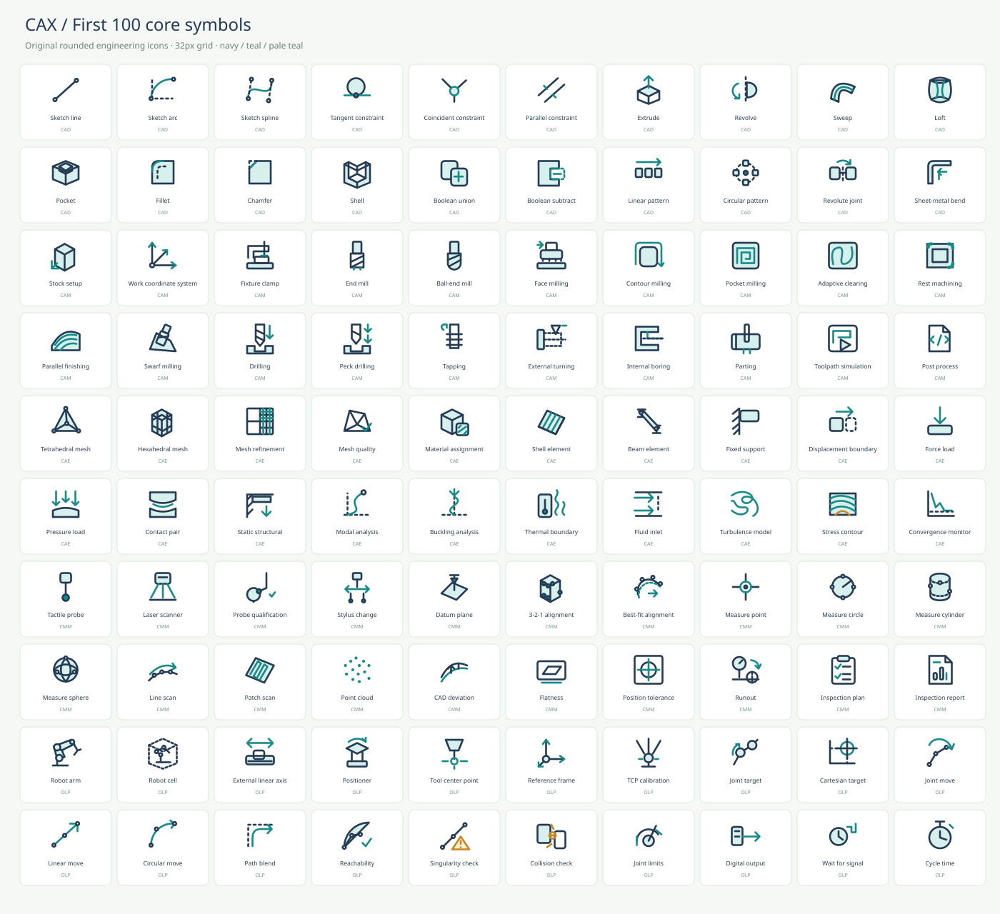

# CAX Iconset

**4,805 original SVG icons for CAD, CAM, CAE, CMM and Robotics / OLP**, with a searchable static web catalog. A soft, rounded 32 px grid and a consistent navy / teal palette.

**100 core symbols + 4,705 geometry / process context variants.** This is not a claim of 4,805 independent software commands. No color-only or rotation-only copies are counted. Shared CAD/CMM centroid symbols count once. See [scope and primary references](docs/REFERENCE.md).



## Browse locally

No npm install, build framework, CDN, account or API key is needed. The generated catalog is included in the repository.

```sh
python3 -m http.server 8000 --bind 127.0.0.1
```

Open `http://127.0.0.1:8000` in a modern browser. The app uses packaged `catalog.js`, so it does not fetch the JSON manifest at runtime. Opening `index.html` directly may also work, subject to browser local-file and clipboard policies. No public deployment is configured or claimed.

- English / Japanese name and tag search, including multiple AND-matched terms
- CAD, CAM, CAE, CMM, OLP and shared-category filters
- Core / context-variant filter, 96-item pagination
- 16 / 24 / 32 / 48 / 64 px previews, light / dark / checker backgrounds
- Detail view, copy SVG, and individual SVG download
- Keyboard focus, `/` search shortcut, native dialog, empty-state reset
- No analytics or runtime external requests

The interface labels are English; the language selector switches icon names between English and Japanese. The JSON manifest includes both.

## Use an icon

Use any file in `icons/`, for example:

```html

```

SVGs use basic vector elements without fonts or external resources. Each standalone file has a title and a 32 × 32 viewBox. When inserting several exported files inline, namespace their internal IDs to avoid collisions. The catalog does this automatically for its own previews.

`manifest.json` includes all icon metadata, SVG body markup, SHA-256 hashes, category counts, and taxonomy source references. `catalog.js` contains the same data for the static web app. These two files are generated; edit `src/` instead.

## Rebuild and verify

Python 3.10+ is sufficient to generate the assets. Node.js is needed only for application tests. The optional whole-collection raster audit additionally needs Inkscape and Pillow already installed in your environment.

```sh
python3 scripts/build.py
python3 tests/test_catalog.py
node --check app.js
node --check catalog.js
node tests/test_app.js
python3 scripts/raster_audit.py
```

To regenerate visual contact sheets:

```sh
python3 scripts/contact_sheet.py
python3 scripts/variant_sheets.py
inkscape qa/core-100.svg --export-type=png --export-filename=qa/core-100.png
```

The variant sheet SVGs can be exported in the same way. Full raster-atlas intermediates are intentionally gitignored.

## Verification status

On 2026-10-17:

- All 4,805 SVGs passed XML, metadata, hash, safe-element and reference validation
- Zero normalized-geometry duplicates
- All 4,805 rendered at 2×: zero blank, clipped/out-of-viewBox, or color-normalized identical raster results
- Ten real-application interaction groups passed in a dependency-free script-level DOM harness
- Representative sheets visually reviewed for core and contextual symbols
- **Actual browser layout, native dialog behavior, system clipboard and download integration were not verified.** The DOM harness is not a browser test. See [QA coverage and manual checklist](docs/QA.md)

Some dense variants need 24–32 px or larger. These are schematic UI illustrations, not exact toolpaths, simulation results, certified GD&T symbols or safe robot programs. See [limitations](docs/REFERENCE.md#intended-use-and-limits).

## Files

- `icons/`: 4,805 individually usable SVGs
- `src/`: original drawing recipes, profiles and source taxonomy
- `scripts/`: deterministic generator and raster/contact-sheet tools
- `tests/`: XML/integrity and application-interaction tests
- `qa/`: visual contact sheets and raster-audit summary
- `docs/`: methodology, primary references and test coverage

## License

[MIT](LICENSE). All icon geometry is original; vendor documentation informed the feature taxonomy, not the artwork.

## 日本語

CAD/CAM/CAE/CMM/ロボットOLP向けのSVGアイコン集と検索Webページです。4,805個は基本100個＋形状や工程の文脈派生4,705個。色・回転だけによる水増しは含みません。商用・OSS製品の一次資料を機能分類の参考にし、丸みのある統一スタイルで作成しました。全SVGの機械検査と描画検査は実施済みですが、Webページの実ブラウザ統合検証は未実施です。
