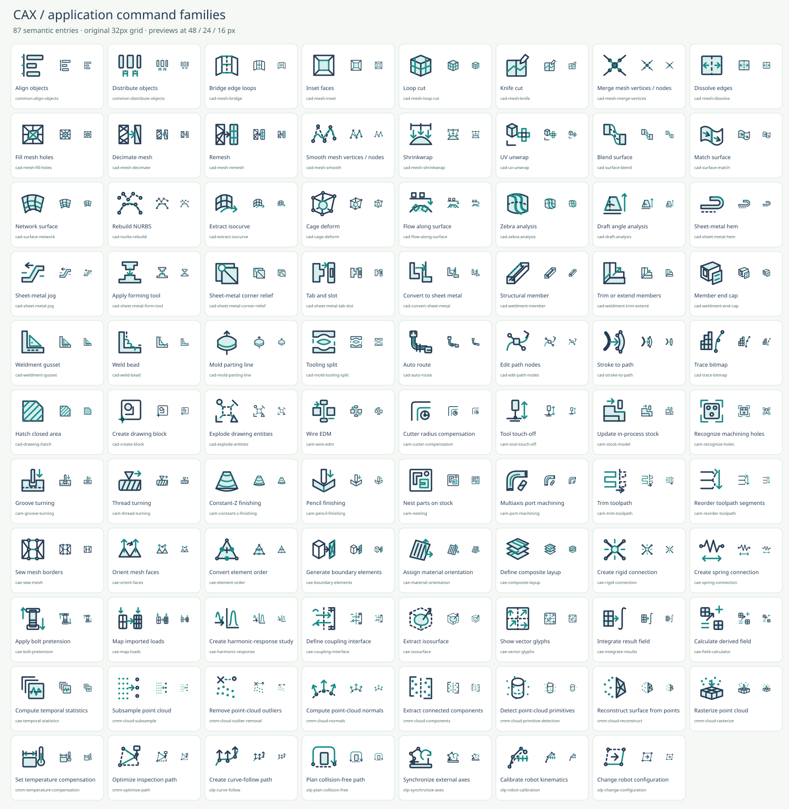

# CAX Iconset

Original rounded SVG symbols for everyday application commands, model-tree objects and CAD, CAM, CAE, CMM and Robotics / OLP. Every entry has a semantic ID, English and Japanese names, bilingual search tags, and a one-sentence purpose in both languages.

**The collection is organized by meaning, not by a target icon count.** Shape/profile/trajectory combinations have been removed from the catalog, source generator and exported SVGs. The previous collection remains recoverable in Git history.



## Coverage

<!-- coverage:start -->
| Primary category | Symbols |
| --- | ---: |
| Common | 72 |
| CAD | 123 |
| CAM | 44 |
| CAE | 52 |
| CMM | 34 |
| OLP | 32 |
| **Total** | **357** |

Primary roles: 341 commands, 5 selectable tools, 8 objects and 3 status symbols. Every SVG is counted once.

141 entries support model-tree use, including reused command/tool symbols; these are not additional SVGs.
<!-- coverage:end -->

- Common: new, open, recent files, close, save / save as / save all, import, export, print, undo / redo, clipboard, search / replace, filtering, selection, display, navigation and application controls
- CAD: sketching, constraints, dimensions, solid features, assembly, sheet metal, weldments, mold tooling, free-form surfaces, mesh editing, vector paths and drawing blocks
- CAM: setup, tooling, milling/turning/EDM operations, stock models, compensation, nesting, toolpath editing, verification and NC output
- CAE: studies, material directions/layups, mesh topology, connections, coupling, boundaries, loads, solver and scalar/vector/derived results
- CMM: probes, calibration, alignment, point-cloud processing/reconstruction, path optimization, temperature compensation, features, tolerances and reporting
- OLP: cell setup, targets, motion, IO, curve-follow/collision-free planning, external-axis synchronization, calibration, simulation and robot programs

Reusable drawing primitives keep the style coherent, but a different section shape, color, orientation or trajectory does not create another catalog entry. Related commands such as Save and Save as remain separate because they perform different actions. Status and tool symbols are identified by `role` rather than advertised as additional commands. See [design, scope and primary references](docs/REFERENCE.md).

## Browse locally

The static catalog is included. No npm install, framework, CDN, account or API key is required.

```sh
python3 -m http.server 8000 --bind 127.0.0.1
```

Open `http://127.0.0.1:8000` in a modern browser. No public deployment is configured or claimed.

- English / Japanese name, tag and purpose search, with multiple AND-matched terms
- Common and five engineering-category filters; 96-item pagination
- Independent usage filter: commands, model-tree nodes, tools and status
- Contextual node names; existing feature, material, mesh, condition and result SVGs are reused
- [Native 16 px model-tree integration](qa/model-tree.png) and [advanced fabrication/mesh/analysis trees](qa/application-model-tree.png)
- 16 / 24 / 32 / 48 / 64 px previews; light / dark / checker backgrounds
- Detail view with bilingual purpose, copy SVG and individual SVG download
- Keyboard focus, `/` search shortcut, native dialog and empty-state reset
- No analytics or runtime external requests

Interface labels are English; the language selector switches icon names and purpose text between English and Japanese.

## Use an icon

```html


```

SVGs use basic vector elements without fonts or external resources. Each file has a title and a 32 × 32 viewBox. Namespace internal IDs if embedding multiple files inline; the catalog handles its preview IDs automatically.

`manifest.json` contains the metadata, original SVG body, SHA-256 hash, primary role, supported usages, contextual node names, category memberships and taxonomy references for each symbol. `catalog.js` contains the same data for the static app. Both are generated: edit `src/` and rebuild. The top-level `categories` counts use each icon’s primary `category` and sum to the unique SVG count; an icon’s `categories` array can also include shared disciplines. `categoryMemberships` records those overlapping browser-filter counts. `role: "object"` means an object-only entry; `usages` can include both `command` and `model-tree` without making another file. See the [application-family expansion review](docs/APPLICATION_EXPANSION.md) for per-function evidence and reuse decisions, and the [earlier model-tree expansion](docs/EXPANSION_REVIEW.md). The optional `aliases` field records alternate application vocabulary; shared categories still produce one SVG.

## Rebuild and verify

Python 3.10+ builds the collection. Node.js runs application tests. The optional raster audit and sheet export use an already-installed Inkscape and Pillow.

```sh
python3 scripts/build.py
python3 tests/test_catalog.py
node --check app.js
node --check catalog.js
node tests/test_app.js
python3 scripts/raster_audit.py
python3 scripts/contact_sheet.py
python3 scripts/model_tree_sheet.py
python3 scripts/application_tree_sheet.py
python3 scripts/update_docs.py
for category in common cad cam cae cmm olp additions application-additions; do
  inkscape "qa/$category.svg" --export-type=png --export-filename="qa/$category.png"
done
inkscape qa/model-tree.svg --export-type=png --export-filename=qa/model-tree.png
inkscape qa/application-model-tree.svg --export-type=png --export-filename=qa/application-model-tree.png
```

The XML/integrity suite checks every SVG, its safe elements, local references, hash, bilingual metadata and normalized geometry. The raster audit checks all entries for blank output, painting outside the viewBox and identical color-normalized renders. Script-level app tests cover filtering, bilingual search, pagination, detail interactions, clipboard fallback and download content.

**These checks are not a real-browser integration test.** Browser layout, native dialog focus/Escape, actual system clipboard and saved downloads remain unverified. See [QA coverage and manual checklist](docs/QA.md).

## Files and license

- `icons/`: individual SVG files; only reviewed semantic entries
- `src/core.py`, `src/common.py`, `src/engineering.py`, `src/extension.py`, `src/application.py`: hand-authored geometry
- `src/application_commands.json`, `src/application_reuse.json`: individually reviewed meanings, references and aliases
- `src/usage.py`: reviewed reuse, object types and model-tree names
- `scripts/`, `tests/`: deterministic build and verification tools
- `qa/`: category contact sheets and complete raster-audit summary
- `docs/`: scope, taxonomy references and QA limits

[MIT](LICENSE). All geometry is original. Vendor documentation informs feature taxonomy, not icon artwork. These UI symbols are schematic, not certified GD&T notation, simulation results or safe robot programs.

## 日本語

一般アプリ操作とCAD/CAM/CAE/CMM/ロボットOLP向けの独自SVGアイコン集です。新規・開く・保存などの基本操作に加え、他アプリの実在機能を参考に、メッシュ編集、自由曲面、点群処理、板金・溶接・金型、2D編集、加工、解析前後処理、ロボット軌道計画を追加しました。

今回の追加は独立した87機能で、全357件です。CAD/CAE共通のメッシュ操作や点群処理の重複候補は統合し、既存機能の別名は検索語と出典の追加で対応しています。断面形状・軌跡・表示状態の掛け算による件数合わせは行いません。141件はモデルツリーにも同じSVGを再利用できます。全件に日英の名前・タグ・用途説明、role/usages、参照資料があります。16pxの階層表示見本を同梱しています。実ブラウザ統合検証は未実施です。
