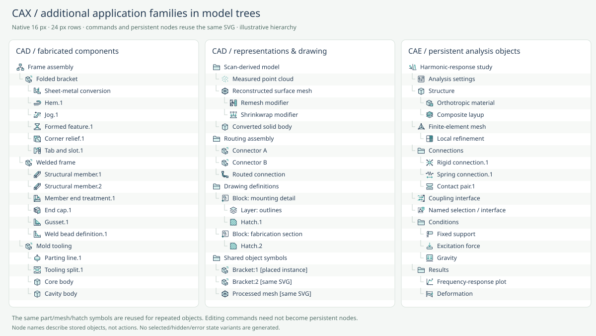

# Additional application command families

Date: 2026-10-17. Baseline: `50ef1ff` (270 entries). This review adds **87 independently selected commands**, giving **357 unique SVGs**. The count follows the selected functions; it is not a target.

## Scope and selection

The added primary-category counts are CAD 41, CMM 9, Common 2, CAM 13, CAE 17, OLP 5. References cover Blender mesh editing, Rhino free-form surfaces, CloudCompare point-cloud processing, SOLIDWORKS sheet metal/weldments/mold tools/routing, Inkscape and QCAD drawing tools, Mastercam/PowerMill/LinuxCNC/SolidCAM manufacturing, SALOME/HyperMesh/Ansys/ParaView analysis, PC-DMIS inspection and RoboDK robotics.

All artwork is independently drawn on the existing 32 px grid. Documentation establishes command semantics; vendor icons are neither traced nor bundled. Historical and versioned references are labeled in the source metadata, without claiming those are current product versions. API, pricing and feature availability are outside this review.

## Reuse and rejected duplication

- Mesh vertex/node merging and smoothing each have one new SVG shared by CAD and CAE, with both application vocabularies and primary sources. There are no duplicate `cae-merge-nodes` or `cae-smooth-mesh` entries.
- Point-cloud outlier filtering, subsampling and surface reconstruction were found in both research streams and merged into one entry each. The same scan-processing entries can be filtered under CAD or CMM.
- Mesh bridge adds faces across a gap; mesh sewing matches existing borders and can insert corresponding nodes; merge by distance collapses coincident nodes. These have different topology effects. B-rep surface sewing remains its own existing command.
- Stock-model calculation produces remaining-stock data. Rest machining cuts residual stock. Constant-Z and pencil finishing are distinct documented machining strategies, not profile or path-shape variants invented to increase the count.
- The generic surface-patch drawing is reused for the geometric patch in a mold shut-off workflow. The host application must still supply core/cavity assignment and mold-specific controls; the patch icon does not claim to implement those controls. No separate shut-off SVG was added.
- Existing parallel finishing, swarf milling, mesh quality, streamlines and best-fit alignment gain application-specific aliases and references instead of synonym icons. ICP is covered by best-fit alignment; its description includes both nominal and reference geometry.
- A weld-bead node represents the documented weld definition/display; it does not claim to create solid weld geometry. Weldment gussets and integral ribs retain separate manufacturing meanings.
- Model-tree support reuses existing command geometry. No hidden/selected/suppressed/error × object variants, section-shape products or trajectory products are generated.

## Persistent model-tree use

23 of the new commands also have reviewed persistent-node uses. Together with existing entries, **141** symbols support model trees. Node names are nouns such as Formed feature, Composite layup and Harmonic-response study. Editing commands do not automatically become persistent nodes.

This 60-row specimen uses native 16 px SVGs and 24 px rows. It is a cross-application integration illustration, not a vendor UI screenshot. Repeated part instances, processed meshes and drawing blocks reuse the same symbol.

## Per-function additions and evidence

The descriptions below state each actual operation. The source JSON also preserves the reviewed difference from existing functions.

### CAD

| Semantic ID | English / Japanese | Purpose | Primary reference |
| --- | --- | --- | --- |
| `cad-mesh-bridge` | Bridge edge loops / 辺ループをブリッジ | Connect existing mesh boundary loops by creating faces between them. | [Blender Bridge Edge Loops](https://docs.blender.org/manual/en/5.2/modeling/meshes/editing/edge/bridge_edge_loops.html) |
| `cad-mesh-inset` | Inset faces / 面をインセット | Create an inset boundary and surrounding faces inside selected mesh faces. | [Blender mesh edit toolbar](https://docs.blender.org/manual/en/latest/modeling/meshes/tools/toolbar.html) |
| `cad-mesh-loop-cut` | Loop cut / ループカット | Insert an edge loop through a connected strip of mesh faces. | [Blender mesh edit toolbar](https://docs.blender.org/manual/en/latest/modeling/meshes/tools/toolbar.html) |
| `cad-mesh-knife` | Knife cut / ナイフカット | Add mesh vertices and edges along an interactively drawn cut. | [Blender mesh edit toolbar](https://docs.blender.org/manual/en/latest/modeling/meshes/tools/toolbar.html) |
| `cad-mesh-merge-vertices` | Merge mesh vertices / nodes / メッシュ頂点・節点統合 | Merge mesh vertices or finite-element nodes that lie within a specified distance tolerance. | [Blender mesh cleanup](https://docs.blender.org/manual/en/latest/modeling/meshes/editing/mesh/cleanup.html); [SALOME merging nodes](https://docs.salome-platform.org/latest/gui/SMESH/merging_nodes.html) |
| `cad-mesh-dissolve` | Dissolve edges / 辺を溶解 | Remove selected mesh edges while joining the neighboring faces without opening holes. | [Blender Deleting and Dissolving](https://docs.blender.org/manual/en/5.0/modeling/meshes/editing/mesh/delete.html) |
| `cad-mesh-fill-holes` | Fill mesh holes / メッシュ穴埋め | Close mesh boundary holes by generating replacement faces. | [Blender mesh cleanup](https://docs.blender.org/manual/en/latest/modeling/meshes/editing/mesh/cleanup.html) |
| `cad-mesh-decimate` | Decimate mesh / メッシュ簡略化 | Reduce the number of mesh faces while limiting changes to the shape. | [Blender mesh cleanup](https://docs.blender.org/manual/en/latest/modeling/meshes/editing/mesh/cleanup.html) |
| `cad-mesh-remesh` | Remesh / リメッシュ | Generate new mesh topology that follows the input surface. | [Blender Remesh modifier](https://docs.blender.org/manual/id/4.5/modeling/modifiers/generate/remesh.html) |
| `cad-mesh-smooth` | Smooth mesh vertices / nodes / メッシュ頂点・節点平滑化 | Reposition mesh vertices or nodes to smooth a surface or improve neighboring element shapes. | [Blender Smooth Vertices](https://docs.blender.org/manual/en/4.5/modeling/meshes/editing/vertex/smooth_vertices.html); [SALOME smoothing](https://docs.salome-platform.org/latest/gui/SMESH/smoothing.html) |
| `cad-mesh-shrinkwrap` | Shrinkwrap / シュリンクラップ | Move mesh vertices onto or near the surface of a target object. | [Blender Shrinkwrap modifier](https://docs.blender.org/manual/en/2.81/modeling/modifiers/deform/shrinkwrap.html) |
| `cad-uv-unwrap` | UV unwrap / UV展開 | Flatten mesh faces across seams into a two-dimensional texture-coordinate layout. | [Blender UV operators](https://docs.blender.org/manual/en/5.4/modeling/meshes/editing/uv.html) |
| `cad-surface-blend` | Blend surface / 曲面ブレンド | Create a transitional surface between two edges with continuity control. | [Rhino blendsrf](https://docs.mcneel.com/rhino/8/help/en-us/commands/blendsrf.htm) |
| `cad-surface-match` | Match surface / 曲面マッチ | Adjust an existing surface edge to match another edge in position, tangency or curvature. | [Rhino matchsrf](https://docs.mcneel.com/rhino/8mac/help/en-us/commands/matchsrf.htm) |
| `cad-surface-network` | Network surface / ネットワーク曲面 | Create a surface through a crossing network of curves in two directions. | [Rhino networksrf](https://docs.mcneel.com/rhino/8mac/help/en-us/commands/networksrf.htm) |
| `cad-nurbs-rebuild` | Rebuild NURBS / NURBS再構築 | Reconstruct curves or surfaces with a specified degree and control-point count. | [Rhino rebuild](https://docs.mcneel.com/rhino/8/help/en-us/commands/rebuild.htm) |
| `cad-extract-isocurve` | Extract isocurve / アイソカーブ抽出 | Create independent curves along selected surface parameter lines. | [Rhino extractisocurve](https://docs.mcneel.com/rhino/8mac/help/en-us/commands/extractisocurve.htm) |
| `cad-cage-deform` | Cage deform / ケージ変形 | Deform enclosed geometry by editing a surrounding control cage. | [Rhino cageedit](https://docs.mcneel.com/rhino/8mac/help/en-us/commands/cageedit.htm) |
| `cad-flow-along-surface` | Flow along surface / サーフェスに沿ってフロー | Morph objects from a base surface onto a target surface. | [Rhino flowalongsrf](https://docs.mcneel.com/rhino/8/help/en-us/commands/flowalongsrf.htm) |
| `cad-zebra-analysis` | Zebra analysis / ゼブラ解析 | Evaluate surface smoothness and continuity with reflected stripe patterns. | [Rhino zebra](https://docs.mcneel.com/rhino/8/help/en-us/commands/zebra.htm) |
| `cad-draft-analysis` | Draft angle analysis / 抜き勾配解析 | Evaluate surface draft angles relative to a chosen pull direction. | [Rhino draftangleanalysis](https://docs.mcneel.com/rhino/8/help/en-us/commands/draftangleanalysis.htm) |
| `cad-sheet-metal-hem` | Sheet-metal hem / 板金ヘム | Create a folded-back edge treatment on a sheet-metal part. | [SOLIDWORKS Hems](https://help.solidworks.com/2024/english/SolidWorks/sldworks/c_Hems.htm?id=474d0dc2a50946878872d45b767b9d21); [Onshape feature and parts lists](https://cad.onshape.com/help/Content/PartStudio/features_and_parts_lists.htm) |
| `cad-sheet-metal-jog` | Sheet-metal jog / 板金ジョグ | Create a sheet-metal offset with two bends based on one sketch line. | [SOLIDWORKS Jogs](https://help.solidworks.com/2024/English/SolidWorks/sldworks/c_Jogs.htm?id=fa64ae6f294049598ffaec44d7f221e4); [Onshape feature and parts lists](https://cad.onshape.com/help/Content/PartStudio/features_and_parts_lists.htm) |
| `cad-sheet-metal-form-tool` | Apply forming tool / フォームツールを適用 | Imprint a forming-tool feature into a sheet-metal target part. | [SOLIDWORKS Using Forming Tools with Sheet Metal](https://help.solidworks.com/2024/English/solidworks/sldworks/c_Forming_Tools.htm); [Onshape feature and parts lists](https://cad.onshape.com/help/Content/PartStudio/features_and_parts_lists.htm) |
| `cad-sheet-metal-corner-relief` | Sheet-metal corner relief / 板金コーナーリリーフ | Add relief geometry where sheet-metal bends meet. | [SOLIDWORKS Corner Relief PropertyManager](https://help.solidworks.com/2023/English/SolidWorks/sldworks/HIDD_SHEET_METAL_CORNER_RELIEF.htm); [Onshape feature and parts lists](https://cad.onshape.com/help/Content/PartStudio/features_and_parts_lists.htm) |
| `cad-sheet-metal-tab-slot` | Tab and slot / タブとスロット | Create matching tabs and slots to locate and join fabricated parts. | [SOLIDWORKS Creating a Tab and Slot](https://help.solidworks.com/2026/english/SolidWorks/sldworks/t_creating_a_tab_and_slot.htm?id=25.1.7.0); [Onshape feature and parts lists](https://cad.onshape.com/help/Content/PartStudio/features_and_parts_lists.htm) |
| `cad-convert-sheet-metal` | Convert to sheet metal / 板金へ変換 | Convert eligible constant-thickness geometry into a sheet-metal model with bend definitions. | [SOLIDWORKS Converting an Imported Part to a Sheet Metal Part](https://help.solidworks.com/2026/english/solidworks/sldworks/t_converting_imported_part_sheet_metal.htm); [Onshape feature and parts lists](https://cad.onshape.com/help/Content/PartStudio/features_and_parts_lists.htm) |
| `cad-weldment-member` | Structural member / 鋼材部材作成 | Create structural members along a sketch framework using a selected standard profile. | [SOLIDWORKS Weldments](https://help.solidworks.com/2026/English/SolidWorks/Sldworks/c_Weldments_Overview.htm) |
| `cad-weldment-trim-extend` | Trim or extend members / 鋼材のトリム・延長 | Trim or extend structural-member ends to meet other members or bodies. | [SOLIDWORKS Weldments Trim and Extend](https://help.solidworks.com/2020/english/SolidWorks/Sldworks/c_Weldments_Trim_and_Extend.htm); [Onshape feature and parts lists](https://cad.onshape.com/help/Content/PartStudio/features_and_parts_lists.htm) |
| `cad-weldment-end-cap` | Member end cap / 鋼材エンドキャップ | Close an open structural-member end with a plate of specified thickness. | [SOLIDWORKS Adding End Caps](https://help.solidworks.com/2026/english/SolidWorks/sldworks/t_adding_an_end_cap.htm?id=35.0.14.0); [Onshape feature and parts lists](https://cad.onshape.com/help/Content/PartStudio/features_and_parts_lists.htm) |
| `cad-weldment-gusset` | Weldment gusset / 溶接構造ガセット | Add a reinforcing plate between structural members. | [SOLIDWORKS Weldments Gussets](https://help.solidworks.com/2026/English/SolidWorks/sldworks/c_Weldments_Gussets.htm?id=58a3c7988bad44a4843f5bbe55cec5a4); [Onshape feature and parts lists](https://cad.onshape.com/help/Content/PartStudio/features_and_parts_lists.htm) |
| `cad-weld-bead` | Weld bead / 溶接ビード | Define a weld bead along the joint between two bodies for model and drawing documentation. | [SOLIDWORKS Weld Beads](https://help.solidworks.com/2026/english/SolidWorks/sldworks/c_Weld_Beads.htm?id=35.0.15) |
| `cad-mold-parting-line` | Mold parting line / 金型パーティングライン | Define the boundary between the core and cavity sides of a molded part. | [SOLIDWORKS Parting Lines](https://help.solidworks.com/2026/english/SolidWorks/sldworks/c_parting_lines.htm?id=d1404aa33b544f98b65f89fcd8c80846); [Onshape feature and parts lists](https://cad.onshape.com/help/Content/PartStudio/features_and_parts_lists.htm) |
| `cad-mold-tooling-split` | Tooling split / 金型分割 | Create core and cavity tooling blocks from prepared mold surfaces. | [SOLIDWORKS Tooling Split PropertyManager](https://help.solidworks.com/2025/english/SolidWorks/sldworks/HIDD_MOLD_CAVITY_CORE_SOLIDS.htm); [Onshape feature and parts lists](https://cad.onshape.com/help/Content/PartStudio/features_and_parts_lists.htm) |
| `cad-auto-route` | Auto route / 自動配線ルート | Generate a routed connection between connectors and optional guide hardware. | [SOLIDWORKS Creating Flexible Ribbon Cable Routes](https://help.solidworks.com/2026/english/SolidWorks/sldpiping/t_creating_flexible_ribbon_cable_routes.htm) |
| `cad-edit-path-nodes` | Edit path nodes / パスノード編集 | Edit a vector path by moving its nodes, handles and segments. | [Inkscape Advanced tutorial: editing paths](https://inkscape.org/es/doc/tutorials/advanced/tutorial-advanced.html?switchlang=es) |
| `cad-stroke-to-path` | Stroke to path / ストロークをパスへ変換 | Convert a vector stroke's visible outline into editable path geometry. | [Inkscape 1.0 release notes: Stroke to Path](https://wiki.inkscape.org/wiki/Release_notes/1.0) |
| `cad-trace-bitmap` | Trace bitmap / ビットマップをトレース | Convert a raster image into editable vector paths. | [Inkscape Tracing bitmaps tutorial](https://inkscape.org/en/doc/tutorials/tracing/tutorial-tracing.ru.html/) |
| `cad-drawing-hatch` | Hatch closed area / 閉領域ハッチング | Fill a closed drawing boundary with a hatch pattern or solid fill. | [QCAD Hatch from Selection](https://qcad.org/doc/qcad/latest/reference/en/scripts/Draw/Hatch/HatchFromSelection/doc/HatchFromSelection_en.html) |
| `cad-create-block` | Create drawing block / 図面ブロック作成 | Create a named reusable drawing block from selected entities and a reference point. | [QCAD Create Block from Selection](https://qcad.org/en/manual/scripts/block/createblock/doc/createblock/) |
| `cad-explode-entities` | Explode drawing entities / 図面要素を分解 | Convert compound drawing entities into their basic editable components. | [QCAD Explode](https://www.qcad.org/doc/qcad/latest/reference/en/scripts/Modify/Explode/doc/Explode_en.html) |

### CMM

| Semantic ID | English / Japanese | Purpose | Primary reference |
| --- | --- | --- | --- |
| `cmm-cloud-subsample` | Subsample point cloud / 点群間引き | Reduce a point cloud by retaining a spatially or numerically chosen subset of its original points. | [CloudCompare Subsample point cloud](https://cloudcompare.org/doc/wiki/index.php/Edit%5CSubsample) |
| `cmm-cloud-outlier-removal` | Remove point-cloud outliers / 点群外れ値除去 | Remove statistically isolated points using distances to neighboring points. | [CloudCompare Remove point-cloud outliers](https://cloudcompare.org/doc/wiki/index.php/SOR_filter) |
| `cmm-cloud-normals` | Compute point-cloud normals / 点群法線計算 | Estimate local surface normals from each point and its neighbors. | [CloudCompare Compute point-cloud normals](https://cloudcompare.org/doc/wiki/index.php/Normals%5CCompute) |
| `cmm-cloud-components` | Extract connected components / 点群連結成分抽出 | Separate a point cloud into connected groups using a chosen spatial gap. | [CloudCompare Extract connected components](https://cloudcompare.org/doc/wiki/index.php/Label_Connected_Components) |
| `cmm-cloud-primitive-detection` | Detect point-cloud primitives / 点群プリミティブ検出 | Detect geometric primitives and their supporting points in a scanned cloud. | [CloudCompare Detect point-cloud primitives](https://cloudcompare.org/doc/wiki/index.php/PluginRansacSD) |
| `cmm-cloud-reconstruct` | Reconstruct surface from points / 点群サーフェス再構成 | Generate a surface mesh from an oriented point cloud using Poisson reconstruction. | [CloudCompare Reconstruct surface from points](https://cloudcompare.org/doc/wiki/index.php/Poisson_Surface_Reconstruction_%28plugin%29) |
| `cmm-cloud-rasterize` | Rasterize point cloud / 点群ラスタ化 | Project point-cloud heights or scalar values onto a regular two-dimensional grid. | [CloudCompare Rasterize point cloud](https://cloudcompare.org/doc/wiki/index.php/Rasterize) |
| `cmm-temperature-compensation` | Set temperature compensation / 測定温度補正設定 | Configure temperature compensation for dimensional measurements. | [PC-DMIS Temperature Compensation](https://docs.hexagonmi.com/pcdmis/2019.1/en/helpcenter/mergedProjects/core/06_pref_topics/Temperature_Compensation.htm) |
| `cmm-optimize-path` | Optimize inspection path / 検査経路最適化 | Optimize tactile measurement order and probe-tip orientations. | [PC-DMIS Optimizing the Path](https://docs.hexagonmi.com/pcdmis/2019.1/en/helpcenter/mergedProjects/core/inspection_plans/Optimizing_the_Path.htm) |

### Common

| Semantic ID | English / Japanese | Purpose | Primary reference |
| --- | --- | --- | --- |
| `common-align-objects` | Align objects / オブジェクト整列 | Align selected objects to a common positional reference. | [Inkscape action reference](https://wiki.inkscape.org/wiki/Action) |
| `common-distribute-objects` | Distribute objects / オブジェクト等間隔配置 | Distribute selected objects with uniform spacing along a chosen direction. | [Inkscape action reference](https://wiki.inkscape.org/wiki/Action) |

### CAM

| Semantic ID | English / Japanese | Purpose | Primary reference |
| --- | --- | --- | --- |
| `cam-wire-edm` | Wire EDM / ワイヤ放電加工 | Create a wire electrical-discharge machining toolpath. | [Mastercam Wire](https://www.mastercam.com/solutions/products/wire/) |
| `cam-cutter-compensation` | Cutter radius compensation / 工具径補正 | Configure the offset between a programmed contour and the actual cutter radius. | [LinuxCNC Tool Compensation](https://linuxcnc.org/docs/html/gcode/tool-compensation.html) |
| `cam-tool-touch-off` | Tool touch-off / 工具タッチオフ | Set a tool-length offset by touching a known reference. | [LinuxCNC Tool Compensation](https://linuxcnc.org/docs/html/gcode/tool-compensation.html) |
| `cam-stock-model` | Update in-process stock / 加工途中素材更新 | Calculate the remaining stock after selected machining operations. | [PowerMill stock model](https://www.autodesk.com/support/technical/article/caas/sfdcarticles/sfdcarticles/How-to-create-a-stock-model-in-PowerMILL.html) |
| `cam-recognize-holes` | Recognize machining holes / 加工穴自動認識 | Identify hole features and derive hole-machining operations. | [SolidCAM automatic feature recognition](https://solidcam.com/de/cam-loesungen/automatische-feature-erkennung/) |
| `cam-groove-turning` | Groove turning / 旋削溝入れ | Create a lathe operation that cuts a groove into a turned part. | [Mastercam Lathe](https://www.mastercam.com/solutions/products/lathe-programming-software/) |
| `cam-thread-turning` | Thread turning / 旋削ねじ切り | Create a synchronized single-point threading operation on a lathe. | [Mastercam Lathe](https://www.mastercam.com/solutions/products/lathe-programming-software/) |
| `cam-constant-z-finishing` | Constant-Z finishing / 等高線仕上げ | Generate finishing passes at successive constant heights. | [PowerMill finishing strategies](https://help.autodesk.com/cloudhelp/2022/ENU/PWRM-ReferenceHelp/files/GUID-B5C85060-9C1C-4EAE-960F-41F89B1E7C1D.htm) |
| `cam-pencil-finishing` | Pencil finishing / ペンシル仕上げ | Trace a finishing path along internal surface junctions. | [PowerMill finishing strategies](https://help.autodesk.com/cloudhelp/2022/ENU/PWRM-ReferenceHelp/files/GUID-B5C85060-9C1C-4EAE-960F-41F89B1E7C1D.htm) |
| `cam-nesting` | Nest parts on stock / 素材へのネスティング | Arrange part outlines or toolpaths to use sheet stock efficiently. | [Mastercam CNC Router nesting](https://www.mastercam.com/solutions/products/cnc-router-software/) |
| `cam-port-machining` | Multiaxis port machining / 多軸ポート加工 | Generate multiaxis toolpaths for the inside of curved ports. | [Mastercam Port Expert](https://www.mastercam.com/solutions/add-ons/port-export/) |
| `cam-trim-toolpath` | Trim toolpath / 工具軌跡トリム | Keep selected portions of a toolpath using a boundary or plane. | [Fusion trim a toolpath](https://help.autodesk.com/view/fusion360/ENU/?contextId=MFG-TRIM-TOOLPATH) |
| `cam-reorder-toolpath` | Reorder toolpath segments / 工具軌跡順序変更 | Change the sequence or direction of cutting segments and their links. | [PowerMill reorder toolpath segments](https://help.autodesk.com/cloudhelp/2022/ENU/PWRM-ReferenceHelp/files/GUID-12327ECE-5C71-4175-B13C-F4E46261C4CB.htm) |

### CAE

| Semantic ID | English / Japanese | Purpose | Primary reference |
| --- | --- | --- | --- |
| `cae-sew-mesh` | Sew mesh borders / メッシュ境界縫合 | Connect mesh borders by matching their nodes and inserting nodes where required for compatible topology. | [SALOME sewing meshes](https://docs.salome-platform.org/latest/gui/SMESH/sewing_meshes.html) |
| `cae-orient-faces` | Orient mesh faces / メッシュ面方向統一 | Make selected mesh-face orientations consistent. | [SALOME orient faces](https://docs.salome-platform.org/latest/gui/SMESH/reorient_faces.html) |
| `cae-element-order` | Convert element order / 要素次数変換 | Convert between linear and quadratic mesh elements. | [SALOME convert to/from quadratic mesh](https://docs.salome-platform.org/latest/gui/SMESH/convert_to_from_quadratic_mesh.html) |
| `cae-boundary-elements` | Generate boundary elements / メッシュ境界要素生成 | Create surface or edge elements on exposed mesh boundaries. | [SALOME generate boundary elements](https://docs.salome-platform.org/latest/gui/SMESH/make_2dmesh_from_3d.html) |
| `cae-material-orientation` | Assign material orientation / 材料方向割当 | Assign local material directions to anisotropic elements. | [HyperMesh Material Orientation](https://help.altair.com/2024/hwdesktop/hwx/topics/pre_processing/aerospace/model_orientation_r.htm) |
| `cae-composite-layup` | Define composite layup / 複合材積層定義 | Define laminate plies, their order and their properties. | [HyperMesh Composite Analysis](https://help.altair.com/hwdesktop/hwx/topics/tutorials/hwx/composite_analysis_t.htm) |
| `cae-rigid-connection` | Create rigid connection / 剛体結合作成 | Couple multiple mesh nodes to a reference node through a rigid connection. | [HyperMesh bracket and cradle preprocessing](https://2022.help.altair.com/2022/hwdesktop/hm/topics/tutorials/hm/hm_4340_pre_processing_for_bracket_and_cradle_analysis_c.htm) |
| `cae-spring-connection` | Create spring connection / ばね結合作成 | Connect model nodes using a spring element and its stiffness properties. | [HyperMesh Springs Panel](https://2022.help.altair.com/2022/hwdesktop/hm/topics/panels/help057.htm) |
| `cae-bolt-pretension` | Apply bolt pretension / ボルト初期軸力設定 | Apply a preload or length adjustment to a modeled bolt. | [Ansys Mechanical Bolt Pretension](https://ansyshelp.ansys.com/public/Views/Secured/corp/v252/en/wb_sim/ds_Pretension.html) |
| `cae-map-loads` | Map imported loads / 外部荷重マッピング | Map externally defined load fields onto the target analysis mesh. | [Ansys Mechanical Importing Loads](https://ansyshelp.ansys.com/public/Views/Secured/corp/v242/en/wb_sim/ds_ext_file_import_loads.html) |
| `cae-harmonic-response` | Create harmonic-response study / 周波数応答解析作成 | Set up a steady-state structural response study for sinusoidal excitation. | [Ansys Harmonic Response](https://ansyshelp.ansys.com/public/Views/Secured/corp/v242/en/wb2_help/wb2h_harmrespAN.html) |
| `cae-coupling-interface` | Define coupling interface / 連成インターフェース定義 | Define a region that exchanges data between coupled physics solvers. | [Ansys System Coupling Region](https://ansyshelp.ansys.com/public/Views/Secured/corp/v242/en/wb_sim/ds_system_coupling_region.html) |
| `cae-isosurface` | Extract isosurface / 等値面抽出 | Extract surfaces where a scalar result equals a specified value. | [ParaView Filtering Data](https://docs.paraview.org/en/latest/UsersGuide/filteringData.html) |
| `cae-vector-glyphs` | Show vector glyphs / ベクトル矢印表示 | Display result-vector direction and magnitude as oriented glyphs. | [ParaView Filtering Data](https://docs.paraview.org/en/latest/UsersGuide/filteringData.html) |
| `cae-integrate-results` | Integrate result field / 結果場の空間積分 | Integrate result values over a line, surface or volume. | [ParaView IntegrateVariables](https://www.paraview.org/paraview-docs/v5.13.2/python/paraview.simple.IntegrateVariables.html) |
| `cae-field-calculator` | Calculate derived field / 派生結果場計算 | Create a derived result array by evaluating expressions on existing fields. | [ParaView Filtering Data](https://docs.paraview.org/en/latest/UsersGuide/filteringData.html) |
| `cae-temporal-statistics` | Compute temporal statistics / 時系列統計計算 | Compute per-location statistics across result timesteps. | [ParaView TemporalStatistics](https://www.paraview.org/paraview-docs/v5.13.2/python/paraview.simple.TemporalStatistics.html) |

### OLP

| Semantic ID | English / Japanese | Purpose | Primary reference |
| --- | --- | --- | --- |
| `olp-curve-follow` | Create curve-follow path / 曲線追従軌道作成 | Generate robot targets and motions from geometric curves and normals. | [RoboDK Curve Follow Project](https://robodk.com/doc/en/Robot-Machining-Curve-Follow-Project.html) |
| `olp-plan-collision-free` | Plan collision-free path / 衝突回避軌道計画 | Find a robot motion path around modeled obstacles. | [RoboDK Collision-Free Motion Planner](https://robodk.com/doc/en/Collision-Avoidance-Collision-Free-Motion-Planner.html) |
| `olp-synchronize-axes` | Synchronize external axes / 外部軸同期設定 | Combine a robot and supported external axes into coordinated motion. | [RoboDK Synchronize Additional Axes](https://robodk.com/doc/en/General-Synchronize-Additional-Axes.html) |
| `olp-robot-calibration` | Calibrate robot kinematics / ロボット機構校正 | Estimate robot kinematic error parameters using measured poses. | [RoboDK Robot Calibration](https://robodk.com/doc/en/Robot-Calibration-LaserTracker.html) |
| `olp-change-configuration` | Change robot configuration / ロボット構え変更 | Choose a kinematic configuration that reaches the target pose. | [RoboDK Robot Configurations](https://robodk.com/doc/en/Interface-Robot-Configurations.html) |

## Existing symbols with expanded vocabulary

| Existing ID | Added search aliases | Primary reference |
| --- | --- | --- |
| `cam-parallel-finishing` | raster finishing, ラスタ仕上げ | [PowerMill Raster Finishing](https://help.autodesk.com/cloudhelp/2022/ENU/PWRM-ReferenceHelp/files/GUID-72851E2B-E8E1-46D9-98F7-B9EB47CE2E4B.htm) |
| `cam-swarf-milling` | swarf finishing, スワーフ仕上げ | [PowerMill Swarf Finishing](https://help.autodesk.com/cloudhelp/2022/ENU/PWRM-ReferenceHelp/files/GUID-B5C85060-9C1C-4EAE-960F-41F89B1E7C1D.htm) |
| `cae-streamline-result` | stream tracer, 流線追跡 | [ParaView filtering data](https://docs.paraview.org/en/latest/UsersGuide/filteringData.html) |
| `cae-mesh-quality` | quality controls, 品質指標, 要素品質 | [SALOME mesh quality controls](https://docs.salome-platform.org/latest/gui/SMESH/index.html) |
| `cmm-best-fit-alignment` | ICP, iterative closest point, fine registration, 詳細位置合わせ | [CloudCompare ICP fine registration](https://cloudcompare.org/doc/wiki/index.php/ICP) |
| `cad-surface-patch` | shut-off patch, 穴閉じパッチ | [SOLIDWORKS Shut-off Surfaces](https://help.solidworks.com/2025/english/solidworks/sldworks/c_shut_off_surfaces.htm) |

## Verification and limits

Independent application-family and manufacturing/analysis reviews found no blocking semantic or visual issues in the 48 / 24 / 16 px additions sheet. All SVGs pass XML safety, local-reference/hash integrity, normalized-geometry uniqueness and a color-normalized raster audit. The additional application aliases and shared-category/model-tree behavior have dedicated regression tests. See [the current QA report](QA.md).

These checks do not establish real-browser layout, native dialog focus/Escape, system clipboard or saved-download behavior. No deployment or CI configuration is added.
