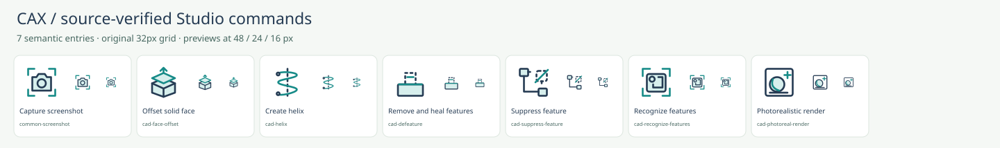
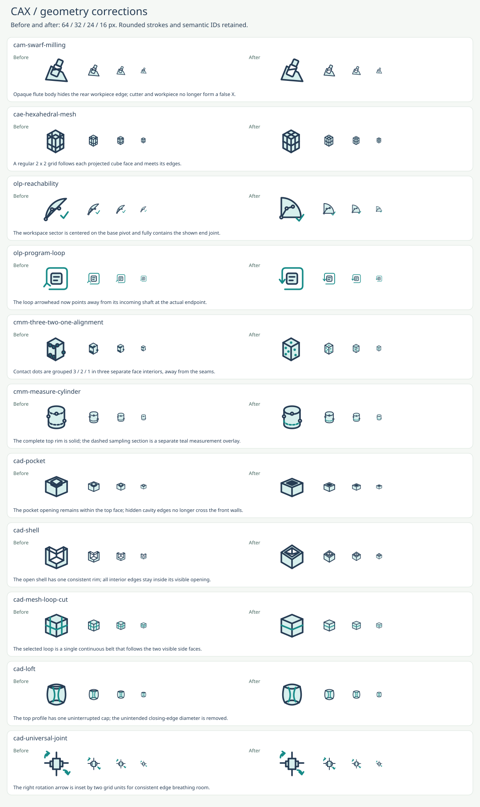
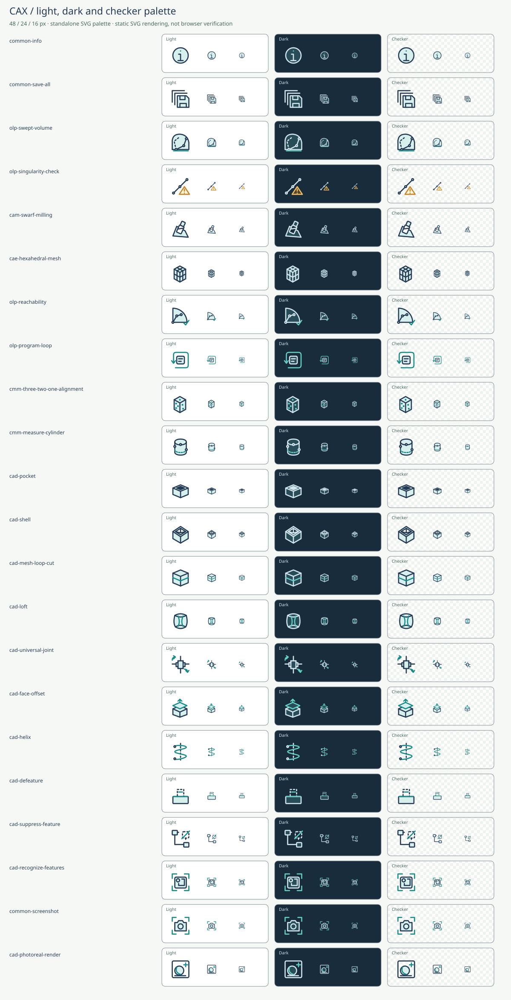

# CAX Studio coverage and geometry review

Date: 2026-10-18. Historical version: 2.4.0. Baseline: the preserved 403-symbol v2.3 tree `0419c0d994e944530fc495a032b11be6750cbeec`; public base commit `cd269ffe836d8a905f2730c29a5ab0538e850474` contains 357 symbols.

This historical pass added **7 independently useful commands**, revised **11 existing drawings**, and enriched **9 reused symbols** without creating synonyms. Its checkpoint contains **410 SVGs**, including **186** symbols with model-tree use. Every existing ID was retained. The later pdxadv additions are documented in [PDXADV_REVIEW.md](PDXADV_REVIEW.md).

## Source scope

The audit read current implementation and command availability in CAX Studio `afe7a7a4abf7896b525be66b695367a819516fdc`, Core `4b96fdeeac2f8aa9fb57a618da1c78aad7627459`, Viewer `ecec36c54e24e1dc91cbe65dd1e83b2384cb0d29` and feature recognition `62319d8a27c6950d9271a52ddab278dd18574bb7`. It also checked related SDK README contracts: caxio `13eb085`, mesh2brep `8dfe1d5`, constraint `fb19a78`, renderer `0a62e3a`, mesher `c616fc4`, collision detection `e8a4a62`, cable simulation `8bf8ad3`, CNC simulation `cc90aa3` and pdxadv `cfe0a2f`.

The per-command sources below pin exact commits. Presence in a command registry was cross-checked against enabled operations and persistent-node mappings where applicable. This is a source-coverage review, not a claim that every application or SDK was compiled or runtime-tested.

## Added meanings

| ID | English / Japanese | Use | Distinction and primary evidence |
| --- | --- | --- | --- |
| `cad-face-offset` | Offset solid face / ソリッド面オフセット | command / model-tree | cad-surface-offset creates an independent surface. This changes faces of an existing solid. [CAX Studio command registry (afe7a7a)](https://github.com/cslroot/cax-studio/blob/afe7a7a4abf7896b525be66b695367a819516fdc/src/commands.ts); [CAX Studio kernel model-tree mapping (afe7a7a)](https://github.com/cslroot/cax-studio/blob/afe7a7a4abf7896b525be66b695367a819516fdc/src/kernelTree.ts#L102-L105); [CAX Core face-offset feature (4b96fde)](https://github.com/cslroot/cax-core/blob/4b96fdeeac2f8aa9fb57a618da1c78aad7627459/crates/cax-modeler/src/session/face_offset_feature.rs#L1-L18) |
| `cad-helix` | Create helix / ヘリックス作成 | command / model-tree | A geometric wire is independent of the existing cad-thread solid-feature command; no radius or pitch variants. [CAX Studio command registry (afe7a7a)](https://github.com/cslroot/cax-studio/blob/afe7a7a4abf7896b525be66b695367a819516fdc/src/commands.ts); [CAX Studio kernel model-tree mapping (afe7a7a)](https://github.com/cslroot/cax-studio/blob/afe7a7a4abf7896b525be66b695367a819516fdc/src/kernelTree.ts#L102-L105) |
| `cad-defeature` | Remove and heal features / フィーチャ除去・修復 | command / model-tree | common-delete deletes selected entities; defeaturing removes local geometry and heals the remaining body. [CAX Studio command registry (afe7a7a)](https://github.com/cslroot/cax-studio/blob/afe7a7a4abf7896b525be66b695367a819516fdc/src/commands.ts); [CAX Studio kernel model-tree mapping (afe7a7a)](https://github.com/cslroot/cax-studio/blob/afe7a7a4abf7896b525be66b695367a819516fdc/src/kernelTree.ts#L102-L105) |
| `cad-suppress-feature` | Suppress feature / フィーチャ抑制 | command | One suppression command, including its reverse toggle. Not display hiding, playback pause, deletion, or per-object state variants. [CAX Studio feature suppression control (afe7a7a)](https://github.com/cslroot/cax-studio/blob/afe7a7a4abf7896b525be66b695367a819516fdc/src/ui/ModelTree.tsx#L64-L73); [CAX Studio suppression evaluation (afe7a7a)](https://github.com/cslroot/cax-studio/blob/afe7a7a4abf7896b525be66b695367a819516fdc/src-tauri/src/state/kernel/part_browser.rs#L495-L542) |
| `cad-recognize-features` | Recognize features / フィーチャ認識 | command | cam-recognize-holes scopes machining holes; this command classifies several independent feature kinds. Recognized results reuse their existing feature icons. [CAX Studio command registry (afe7a7a)](https://github.com/cslroot/cax-studio/blob/afe7a7a4abf7896b525be66b695367a819516fdc/src/commands.ts); [CAX feature recognition (62319d8)](https://github.com/cslroot/cax-feature-recognition/blob/62319d8a27c6950d9271a52ddab278dd18574bb7/README.md#L3-L39) |
| `common-screenshot` | Capture screenshot / スクリーンショット保存 | command | Captures the existing displayed view; does not run a photorealistic render or export model geometry. [CAX Studio command registry (afe7a7a)](https://github.com/cslroot/cax-studio/blob/afe7a7a4abf7896b525be66b695367a819516fdc/src/commands.ts) |
| `cad-photoreal-render` | Photorealistic render / フォトリアル描画 | command | A new image is computed by the renderer. It is independent of capturing the current viewport or changing display style. [CAX Studio command registry (afe7a7a)](https://github.com/cslroot/cax-studio/blob/afe7a7a4abf7896b525be66b695367a819516fdc/src/commands.ts); [CAX Studio photo renderer (afe7a7a)](https://github.com/cslroot/cax-studio/blob/afe7a7a4abf7896b525be66b695367a819516fdc/src/ui/PhotoRenderDialog.tsx#L25-L29) |

## Reuse and exclusions

- Recognize is an analysis action. Recognized thread results reuse `cad-thread`; no recognized/unrecognized pairs are generated. Thread recognition is **B-rep-only** at the reviewed implementation, even though the overall recognition library supports both B-rep and mesh inputs.
- A helix is a 3D curve, not a thread feature. Face offset changes an existing solid, whereas offset surface creates independent surface geometry. Defeature removes and heals local features; Delete removes selected entities. Suppression retains the definition but skips evaluation; Hide changes display visibility.
- Face offset, helix and defeature have persistent node uses. Recognition, suppression, screenshot and photoreal rendering do not create new model entity classes in this catalog.
- Generic import/export, object visibility, folder, rename, assembly placement, BOM and geometry conversion reuse existing entries. File formats, conversion methods, robot shapes, object states and tessellation settings do not create extra SVGs.
- Face move, face rotate and range stretch remain possible future candidates. They were not misleadingly aliased to whole-body move/rotate/scale. Core curve sampling is internal display processing with no independently verified UI action, so no command icon is added.

| Reused ID | Added vocabulary | Review decision |
| --- | --- | --- |
| `cad-thread` | recognized thread, detected thread, 認識ねじ | Recognition is an action; the identified thread is still a thread feature and uses cad-thread. |
| `cad-fillet` | sketch fillet, face reblend, reblend radius, スケッチ角丸め, 再ブレンド | Round corners or edges with the existing fillet meaning; do not create input-context variants. |
| `cad-chamfer` | sketch chamfer, スケッチ面取り | Sketch and solid edge beveling share the chamfer symbol. |
| `cad-draft` | face draft, 面勾配 | Draft applied to selected faces reuses the existing draft feature. |
| `cad-linear-pattern` | translated feature copies, face copy feature, フィーチャ並進複製 | Translate repeated feature geometry using the existing linear-pattern meaning. |
| `cad-mirror` | mirror feature copies, フィーチャ鏡映複製 | Mirrored copies reuse the existing mirror operation. |
| `cad-assembly-place` | insert component, 部品挿入 | Insertion of a component is assembly placement, not a new object class. |
| `cad-bill-of-materials` | assembly BOM, アセンブリ部品表 | Assembly BOM uses the existing bill-of-materials command. |
| `cad-mesh-to-brep` | faceted conversion, analytic surface fitting, quad conversion, subd conversion, hybrid mesh conversion, ファセット変換, 解析曲面フィット, 細分割変換 | The five conversion methods are modes of one mesh-to-B-rep operation, not separate icon meanings. |

## Geometry corrections

All 403 baseline entries were inspected at native 16 / 24 / 32 px and diagnostic enlargements. Intentional mesh/wireframe intersections, coordinate origins, dashed workspace envelopes and measurement overlays were separated from accidental occlusion or projection errors. Nine corrections address geometry or measurement conventions; two are small optical cleanups. The seven added commands were reviewed separately. The independent post-fix pass also rendered and inspected all 410 symbols in the current dark palette at native 32 / 24 / 16 px; no remaining visual blocker was found.

| ID | Correction |
| --- | --- |
| `cam-swarf-milling` | Opaque flute body hides the rear workpiece edge; cutter and workpiece no longer form a false X. |
| `cae-hexahedral-mesh` | A regular 2 x 2 grid follows each projected cube face and meets its edges. |
| `olp-reachability` | The workspace sector is centered on the base pivot and fully contains the shown end joint. |
| `olp-program-loop` | The loop arrowhead now points away from its incoming shaft at the actual endpoint. |
| `cmm-three-two-one-alignment` | Contact dots are grouped 3 / 2 / 1 in three separate face interiors, away from the seams. |
| `cmm-measure-cylinder` | The complete top rim is solid; the dashed sampling section is a separate teal measurement overlay. |
| `cad-pocket` | The pocket opening remains within the top face; hidden cavity edges no longer cross the front walls. |
| `cad-shell` | The open shell has one consistent rim; all interior edges stay inside its visible opening. |
| `cad-mesh-loop-cut` | The selected loop is a single continuous belt that follows the two visible side faces. |
| `cad-loft` | The top profile has one uninterrupted cap; the unintended closing-edge diameter is removed. |
| `cad-universal-joint` | The right rotation arrow is inset by two grid units for consistent edge breathing room. |

## Preview theme correction

The former dark preview replaced ink with light blue while leaving body surfaces pale, erasing clock hands, mesh edges, sensor centers and other internal details. At that checkpoint, a preview-only CSS adapter mapped each color role independently. Pale body fill becomes `#294c59`, ink `#d1e5ed`, and teal accent `#63cec4` on `#192c3c`. Opaque white node masks remain opaque using the dark background color; `fill="none"` and `stroke="none"` remain untouched. The soft glow was removed to avoid 16 px blur. Light/checker previews and copied/downloaded source SVG palettes were unchanged at that checkpoint. Current standalone light/dark exports are documented in [DARK_THEME.md](DARK_THEME.md).

The palette's calculated contrasts are **7.1:1** for ink on body and **4.91:1** for accent on body. These are color-role calculations, not a browser-computed-style audit or accessibility certification.

The 22-example sheet includes every new and revised drawing plus representative dark-palette failures. The palette is now centralized in `src/themes.py`; the regenerated sheet preserves the reviewed colors and is a static SVG render, not a browser screenshot.

## Verification and limits

- Python: 9 groups covering XML safety, hashes, roles, bilingual metadata, source records, reuse, reviewed geometry and normalized uniqueness
- JavaScript: 15 script-level groups, including CAX command search, persistent-node labels, recognized-result reuse, all three preview selections, palette scoping and unchanged standalone copy/download data
- Raster: all 410 SVGs at the v2.4 checkpoint, zero empty output, zero viewBox overflow and zero identical color-normalized renders
- Reproducible category, additions, native model-tree, correction and theme sheets
- Actual browser integration remains **unverified**. The supported cloud browser rejected the local `file:` URL; no alternate browser-control route was used to bypass that policy. CSS computed styles, native dialog focus/Escape, real clipboard and saved downloads therefore remain on the manual checklist.

See [QA.md](QA.md) for the current verification report. These are UI symbols, not certified manufacturing, GD&T or robot-safety controls.
