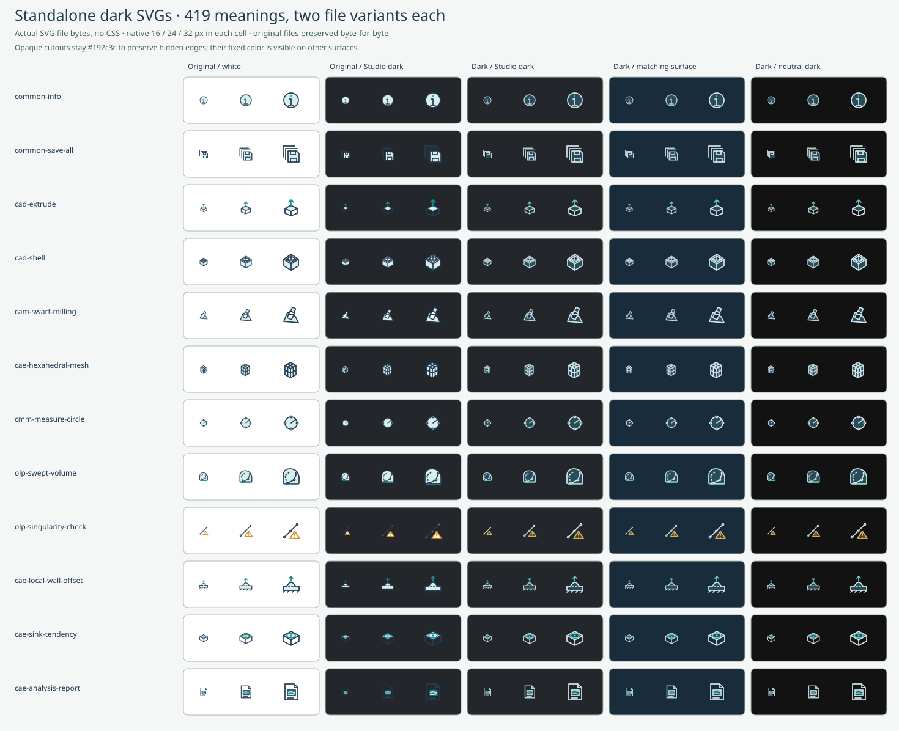

# Standalone light and dark SVG variants

Version 2.6.0. There are **419 semantic IDs**, each with a light and dark file. The catalog, category totals, usage totals and searches still count 419 icons. No new meanings, state variants or geometry are introduced. All 419 original SVG files match commit `08d22603e7b21b47da35f67025ba36a6572c3c95` byte-for-byte.



Each cell has a **16 / 24 / 32 px output size**. The comparison embeds actual file bytes as independent SVG images, without host CSS. Inkscape may rasterize those images at their intrinsic 32 px size before scaling them, so this atlas is not equivalent to direct native-size vector rasterization. It includes original-on-dark failures, standalone dark files on CAX Studio's #23262b, the intended #192c3c surface and neutral #121212. It is a static Inkscape render, not a browser screenshot or a CAX Studio integration test.

## Choose a file explicitly

```html


```

The paths contain the same semantic ID. The original `file`, `body` and `sha256` manifest fields keep their light-file meanings for backward compatibility. New consumers should use `item.variants[theme].file` and `item.variants[theme].sha256`, where `theme` is `light` or `dark`. The top-level `themes` object provides the palette and intended surface. `variants.dark.body` supplies the generated dark body for inline previews; light keeps using `item.body`.

The browser's **SVG** selector and detail view's **Icon theme** selector select the file palette. They stay synchronized. Background swatches are independent surface tests; choosing a dark background alone does not secretly change an original SVG. Cards, detail, copy and download use the selected variant. The detail view shows its exact repository path. Dark downloads use `<id>.dark.svg`; light downloads retain `<id>.svg`. Their bytes, including the accessible title and final newline, match the corresponding repository files. The same selected palette also feeds [transparent PNG export](PNG_EXPORT.md) at an explicitly chosen pixel size; the preview surface is excluded while opaque cutouts are retained.

An application can choose the light or dark path based on its own theme. These assets do not inspect operating-system preferences or recolor themselves. Host `color` properties do not affect the external `` SVG. No CSS filter, `currentColor`, external stylesheet, script, font or remote resource is required. For inline SVG, namespace internal IDs and references if several instances coexist; the catalog does this for each preview.

## Palette and opaque cutouts

`src/themes.py` is the single source of truth. The build changes only fill/stroke colors. Element order, paths, dimensions, widths, cap/join styles, transforms, clip paths and transparency remain unchanged.

| Role | Light | Dark |
| --- | --- | --- |
| Ink and interior edges | #253b53 | #d1e5ed |
| Body surface | #d7efed | #294c59 |
| Accent | #178b88 | #63cec4 |
| Warning | #c88626 | #efbd63 |
| Warning body | #fff3da | #51432c |
| Opaque cutout | white | #192c3c |

The dark variant targets **#192c3c**. There are **184 opaque white fills in 64 original icons**. These include node circles, overlapping tool bodies and intentional openings that cover earlier lines. Turning them transparent would reveal hidden geometry and change the icon. Dark variants therefore retain opaque **#192c3c** fills. The surrounding canvas is still transparent; there is no full-viewport background rectangle.

On another surface, those fills can appear as darker/lighter inset patches. The #23262b and #121212 sheets show this honestly. The drawings retain their occlusion and high-contrast outlines, but the fixed fills do **not** promise seamless background matching. This is a design constraint, not automatic arbitrary-surface adaptation.

For exact integration with another dark surface, deliberately set both `THEMES['dark']['surface']` and `THEMES['dark']['palette']['cutout']` in `src/themes.py` to the application's intended color, rebuild, and rerun the theme audit on that surface. The audit includes the configured surface plus #23262b and #121212; update its `SURFACES` list for any further integration targets. The detail note reads the generated palette, while bundled-palette regression expectations, static comparison labels and documentation must be reviewed when intentionally changing the palette. Review the body's and accents' contrasts too. Do not replace cutouts with `none` or change every fill to the same foreground color. Changes to the bundled palette require review; they are not inferred from preview backgrounds.

## Rebuild and verification

```sh
python3 scripts/build.py
python3 tests/test_catalog.py
node tests/test_app.js
python3 scripts/dark_theme_audit.py
```

The audit embeds each raw file as a separate SVG image in an atlas with 16 / 24 / 32 px output cells. These are atlas measurements, including possible resampling from the source image’s intrinsic 32 px size. It compares their alpha channels, rejects blank renders and checks that each dark icon retains at least eight pixels of 3:1 contrast against each tested surface. That pixel threshold detects gross visibility failures, not recognizability or accessibility conformance. Static palette contrast is 7.10:1 for ink/body, 4.91:1 for accent/body, and at least 7.61:1 for the accent against the three tested dark surfaces.

XML tests cover both variants, exact hashes, local-reference safety, exhaustive palette roles, unchanged structure/geometry/order, all opaque cutouts and the 419-original baseline. Script-level application tests copy and download all **838** files and require exact equality with the selected standalone file. They cover repeated theme/background changes and restoration of focus to the detail opener after a theme switch.

Results: [machine-readable audit](../qa/dark-theme-audit.json), [QA report](QA.md). Complete three-surface embedded-SVG sheets: [Common](../qa/dark-common.png), [CAD](../qa/dark-cad.png), [CAM](../qa/dark-cam.png), [CAE](../qa/dark-cae.png), [CMM](../qa/dark-cmm.png), [OLP](../qa/dark-olp.png).

The [PNG export audit](PNG_EXPORT.md) separately renders all original files directly at seven requested sizes and checks real PNG pixels. It is Inkscape evidence, not execution of browser Canvas or browser PNG downloads. Real-browser layout, native dialog focus/Escape, clipboard permissions and actual saved downloads remain unverified. The earlier browser local-file restriction was not bypassed. This change does not edit or deploy CAX Studio or configure CI.
