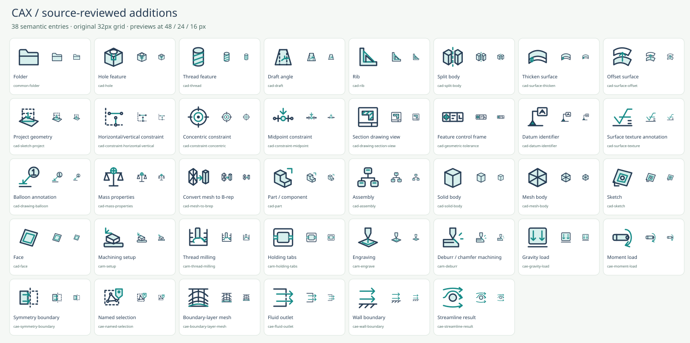
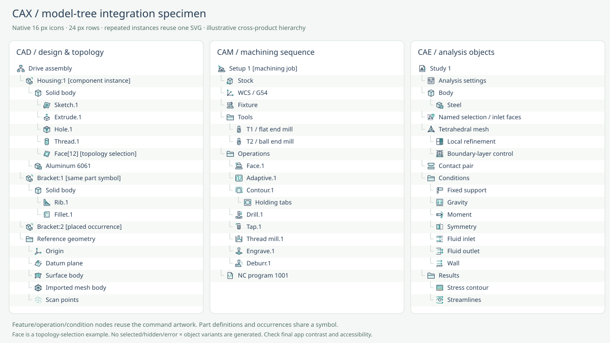

# Source-reviewed expansion and model-tree use

Date: 2026-10-17. Baseline: `1547089` (232 semantic entries). Current source build: 270 entries. The 38 additions below follow missing functionality and object types found in primary application documentation. **38 is a result, not a target.** No profile, trajectory, color or state Cartesian products have been reintroduced.

## Decisions and functional differences

### CAD: 18 missing independent commands

| Added IDs (`cad-` prefix) | Reason they are separate | Primary evidence |
| --- | --- | --- |
| `hole`, `thread`, `draft`, `rib` | Parameterized hole, helical thread, face draft and reinforcing wall have different modeling effects; neither pocket nor chamfer covers them | [SOLIDWORKS Features toolbar](https://help.solidworks.com/2026/english/SolidWorks/sldworks/r_Features_Toolbar.htm?id=2.12.4.1.11), [FreeCAD PartDesign command registration](https://github.com/FreeCAD/FreeCAD/blob/main/src/Mod/PartDesign/Gui/Workbench.cpp) |
| `split-body` | Separates material into bodies without discarding a Boolean subtraction volume | [Onshape Split](https://cad.onshape.com/help/Content/PartStudio/split.htm) |
| `surface-thicken`, `surface-offset` | Thickening produces solid volume; an offset is another surface. Shelling starts with a solid | [Thicken](https://cad.onshape.com/help/Content/PartStudio/thicken.htm), [Offset surface](https://cad.onshape.com/help/Content/PartStudio/offset_surface.htm) |
| `sketch-project` | References external edges on a sketch plane rather than copying or offsetting sketch entities | [Onshape Use](https://cad.onshape.com/help/Content/Sketch/use.htm) |
| `constraint-horizontal-vertical`, `constraint-concentric`, `constraint-midpoint` | Axis alignment, shared circle centers and point-at-half-length are different constraints | [Fusion sketch constraints](https://help.autodesk.com/cloudhelp/ENU/Fusion-Sketch/files/SKT-CONSTRAINTS.htm) |
| `drawing-section-view` | Produces a linked drawing view rather than clipping the 3D display | [Fusion Drawing toolbar](https://help.autodesk.com/cloudhelp/ENU/Fusion-Drawing/files/DWG-REF-DRAWING-TAB.htm) |
| `geometric-tolerance`, `datum-identifier`, `surface-texture`, `drawing-balloon` | Distinct tolerance, datum, surface-finish and BOM-item annotation functions | [Fusion Drawing toolbar](https://help.autodesk.com/cloudhelp/ENU/Fusion-Drawing/files/DWG-REF-DRAWING-TAB.htm) |
| `mass-properties` | Computes mass, center of mass and inertia, rather than editing generic object properties | [Onshape Mass properties](https://cad.onshape.com/help/Content/View/mass_properties_tool.htm) |
| `mesh-to-brep` | Converts a faceted representation to a boundary representation; it is neither import nor finite-element meshing | [Fusion Convert Mesh](https://help.autodesk.com/cloudhelp/ENU/Fusion-Mesh/files/MESH-CONVERT-TO-SOLID.htm) |

### Persistent objects: eight new symbols

| Added ID | Why a separate object is useful |
| --- | --- |
| `common-folder` | A persistent container without the creation plus in `common-folder-new` |
| `cad-part` | A part/component definition can contain several bodies and features; its placed occurrences reuse this same glyph |
| `cad-assembly` | A hierarchy of component instances and relationships |
| `cad-solid-body` | A closed solid volume, distinct from its containing part |
| `cad-mesh-body` | A faceted geometry representation, distinct from a finite-element volume mesh |
| `cad-sketch` | The entire sketch container, not one line or circle |
| `cad-face` | One bounded B-rep face, for topology/selection trees; this does not claim that every application exposes faces in its default feature tree |
| `cam-setup` | A machining job containing stock, coordinates, fixtures and operations, rather than stock alone |

Primary evidence: [Onshape feature/parts lists](https://cad.onshape.com/help/Content/PartStudio/features_and_parts_lists.htm), [assembly instances](https://cad.onshape.com/help/Content/Assembly/instances_list.htm), [SOLIDWORKS multibody parts](https://help.solidworks.com/2026/English/SolidWorks/Sldworks/c_Multibody_Overview.htm), [Fusion components and occurrences](https://help.autodesk.com/cloudhelp/ENU/Fusion-360-API/files/ComponentsProxies_UM.htm), [BRepFace](https://help.autodesk.com/cloudhelp/ENU/Fusion-360-API/files/fusion_BRepFace.htm), [Fusion Manufacture browser](https://help.autodesk.com/cloudhelp/ENU/Fusion-CAM/files/GUIDB87E0180-7CDD-41B0-866C-EEDACB946E09.htm).

### CAM: four missing operations/controls

| Added ID | Difference from existing functionality | Primary evidence |
| --- | --- | --- |
| `cam-thread-milling` | A smaller cutter follows helical interpolation; tapping instead synchronizes axial feed with a thread-form tool | [Fusion 2D Thread](https://help.autodesk.com/cloudhelp/ENU/Fusion-CAM/files/2D-THREAD-STEPS.htm) |
| `cam-holding-tabs` | Leaves bridges of the stock itself rather than using an external clamp | [Fusion 2D Contour](https://help.autodesk.com/view/fusion360/ENU/?contextId=MFG-REF-2D-CONTOUR-CMD), [FreeCAD holding tags](https://github.com/FreeCAD/FreeCAD-documentation/blob/main/wiki/CAM_DressupTag.md) |
| `cam-engrave` | V-tool depth controls variable groove width and sharp corners | [Fusion Engrave](https://help.autodesk.com/view/fusion360/ENU/?contextId=MFG-REF-2D-ENGRAVE-CMD) |
| `cam-deburr` | Physical cutter-based edge finishing rather than modeling a CAD chamfer | [Fusion 2D Chamfer](https://help.autodesk.com/view/fusion360/ENU/?contextId=2D-CHAMFER-STEPS), [Mastercam Deburr](https://www.mastercam.com/community/blog/10-mastercam-2025-features-you-need-to-know/) |

The holding-tag document is archived official FreeCAD documentation; it supports object semantics, not a claim about the latest UI. Product version limitations are retained in reference metadata.

### CAE: eight missing conditions, controls and results

| Added ID | Difference from existing functionality | Primary evidence |
| --- | --- | --- |
| `cae-gravity-load` | Body load tied to mass/acceleration rather than a concentrated force | [Ansys Gravity](https://ansyshelp.ansys.com/public/Views/Secured/corp/v261/en/wb_sim/ds_Gravity.html) |
| `cae-moment-load` | Rotational moment rather than linear force | [Ansys Moment](https://ansyshelp.ansys.com/public/Views/Secured/corp/v261/en/wb_sim/ds_Moment.html) |
| `cae-symmetry-boundary` | Simulation DOF restriction rather than geometric mirroring | [Ansys Symmetry Region](https://ansyshelp.ansys.com/public/Views/Secured/corp/v251/en/mech_obj/ds_Symmetry_Region_o_r.html) |
| `cae-named-selection` | A reusable assignment scope of geometry/mesh entities, not merely visual grouping | [Gmsh physical groups](https://gmsh.info/doc/texinfo/gmsh.html#Elementary-entities-vs-physical-groups) |
| `cae-boundary-layer-mesh` | Graded wall-normal layers rather than undirected local refinement | [Ansys Inflation](https://ansyshelp.ansys.com/public/views/secured/corp/v252/en/wb_msh/ds_Inflation.html) |
| `cae-fluid-outlet`, `cae-wall-boundary` | Outflow and impermeable-wall conditions differ from inflow conditions | [OpenFOAM boundary conditions](https://doc.openfoam.com/2306/tools/processing/boundary-conditions/) |
| `cae-streamline-result` | Traces a vector field rather than displaying a scalar contour or XY series | [OpenFOAM streamLine](https://doc.openfoam.com/2306/tools/post-processing/function-objects/field/streamLine/) |

## Reuse rather than proliferation

- Feature nodes use their creation-command glyph, matching the [Onshape feature-list principle](https://cad.onshape.com/help/Content/PartStudio/features_and_parts_lists.htm). New glyphs are not created for “extrude feature” versus “extrude command.”
- `cad-part` covers the definition and placed component instances; occurrence names and the parent hierarchy identify individual instances.
- `cad-surface-patch` covers a surface-body node; `cad-datum-plane` and `cad-datum-axis` cover their persistent references.
- `cae-material-assignment` also appears in CAD; `cmm-point-cloud` also appears in CAD; `olp-reference-frame` also appears in CAD/CAM/CAE. Shared category membership does not duplicate a file.
- `cam-post-process` already has neutral code-document geometry, so it is reused as an NC-program node rather than adding another NC icon.
- `cae-new-study` retains its command ID and semantics; the creation plus was replaced by a neutral analysis-document motif so the same glyph can represent an existing study.
- Existing meshes, material, contacts, load/boundary conditions and results receive node metadata. Solver settings gains an “Analysis settings” node name, supported by the [Ansys analysis tree](https://ansyshelp.ansys.com/public/Views/Secured/corp/v252/en/mech_obj/ds_Environment_o_r.html).
- No hidden/selected/suppressed/error/locked × object family is generated. States should be separate indicators in the consuming UI.

## Model-tree integration

The specimen contains 58 native 16 px rows across CAD, CAM and CAE. It deliberately shows parts and instances, bodies and faces, sketch/feature history, materials, machining setup and operation order, mesh controls, conditions and results. It is a static illustration, not a browser screenshot or a claim that every application uses the same hierarchy. Labels are necessary for small technical annotations and accessibility.

The browser filters `usages` independently from categories. Selecting Model-tree nodes switches to contextual noun labels; combined category/search filtering still emits each SVG once. Reset clears both filters. No additional runtime dependency was added.

## Review and verification

Independent CAD and CAM/CAE reviews checked semantic distinctness, primary-source mapping, reuse choices and the 16 px images. Both found no blocking issues after reference and metadata corrections. All 270 SVGs passed XML/safety/hash/geometry checks and the normalized raster audit. The application passes 11 script-level interaction groups. These are not real-browser integration tests. See [QA and limitations](QA.md).
