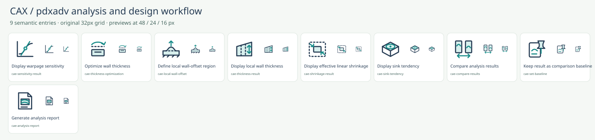
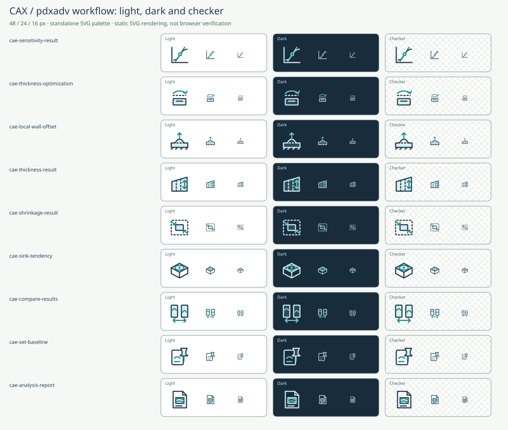

# pdxadv analysis and design workflow

Date: 2026-10-18. Historical version: 2.5.0. Baseline: `490d20684866e39c7075485bf2dc95abb95dd341` (410 symbols).

This pass adds **9 independent meanings** selected from implemented pdxadv workflows: six analysis/design meanings and three supporting result actions. This historical checkpoint contained **419 unique SVGs**, including **186** model-tree-compatible entries. All **410 existing SVG files remain byte-for-byte unchanged**. The count follows useful functions; no numerical target or state/format product is used.

## Source scope

Implementation evidence is pinned to [`cslroot/cax-pdxadv` commit `40cc394fd59e18b76f48efa1161a25d460bafc6d`](https://github.com/cslroot/cax-pdxadv/tree/40cc394fd59e18b76f48efa1161a25d460bafc6d). The audit inspected result-field definitions, coordinate-search optimization, local mesh deformation, baseline/comparison controls and report assembly. This establishes vocabulary and scope; pdxadv itself was not compiled or runtime-tested for this icon task.

All nine entries are display/design/report commands. The local wall patch has a region list in pdxadv, but hierarchical model-tree display was not established, so this pass does not add model-tree claims.

## Nine additions and evidence

| ID | English / Japanese | Meaning and limits | Pinned primary sources |
| --- | --- | --- | --- |
| `cae-sensitivity-result` | Display warpage sensitivity / そり感度表示 | Display the derivative of the warpage objective with respect to element isotropic linear shrinkage, including raw, normalized and density views. One sensitivity family. The derivative is with respect to isotropic linear shrinkage, not thickness; thickness changes require reanalysis. Normalized/density/contribution views do not create extra SVGs. | [pdxadv result-field definitions (40cc394)](https://github.com/cslroot/cax-pdxadv/blob/40cc394fd59e18b76f48efa1161a25d460bafc6d/web/viewport.js#L3-L37) |
| `cae-thickness-optimization` | Optimize wall thickness / 肉厚対策・最適化 | Explore bounded wall-thickness candidates by coordinate search with remeshing and reanalysis, subject to volume limits and locked parameters. Not topology optimization, a direct shape update from sensitivity, or a guarantee of a global optimum. A loop around wall candidates expresses repeated evaluation. | [pdxadv bounded coordinate-search advisor (40cc394)](https://github.com/cslroot/cax-pdxadv/blob/40cc394fd59e18b76f48efa1161a25d460bafc6d/src/workflow.rs#L401-L556) |
| `cae-local-wall-offset` | Define local wall-offset region / 局所肉厚変更領域 | Define a radius-bounded local analysis-mesh offset with an explicit fixed back plane while retaining the imported source geometry. A region has anchor, normal, radius, depth, offset and lock parameters. This is neither B-rep face offset nor generic mesh smoothing. The UI has a patch list; no actual hierarchical model-tree use is claimed. | [pdxadv local wall modifier (40cc394)](https://github.com/cslroot/cax-pdxadv/blob/40cc394fd59e18b76f48efa1161a25d460bafc6d/src/design.rs#L1-L85); [pdxadv baseline, comparison and report actions (40cc394)](https://github.com/cslroot/cax-pdxadv/blob/40cc394fd59e18b76f48efa1161a25d460bafc6d/web/app.js#L440-L472) |
| `cae-thickness-result` | Display local wall thickness / 局所肉厚分布 | Display specified wall thickness for parametric geometry or estimated local thickness from opposing rays with voxel fallback for imported geometry. A distributed scalar result, not creating thickness with CAD Thicken and not a generic point-to-point distance tool. | [pdxadv result-field definitions (40cc394)](https://github.com/cslroot/cax-pdxadv/blob/40cc394fd59e18b76f48efa1161a25d460bafc6d/web/viewport.js#L3-L37) |
| `cae-shrinkage-result` | Display effective linear shrinkage / 有効線収縮率 | Display the effective isotropic linear-shrinkage equivalent computed by the material law. Linear shrinkage is not volumetric shrinkage. This is a computed result field, not a geometry-scaling action. | [pdxadv result-field definitions (40cc394)](https://github.com/cslroot/cax-pdxadv/blob/40cc394fd59e18b76f48efa1161a25d460bafc6d/web/viewport.js#L3-L37) |
| `cae-sink-tendency` | Display sink tendency / ヒケ傾向 | Display an uncalibrated sink-tendency index from linear shrinkage and relative local wall thickness, without claiming measured sink depth. The reference index is 100 × linear shrinkage × (local thickness / median thickness)^2. No calibrated defect depth, measured dent or confirmed failure is claimed. | [pdxadv result-field definitions (40cc394)](https://github.com/cslroot/cax-pdxadv/blob/40cc394fd59e18b76f48efa1161a25d460bafc6d/web/viewport.js#L3-L37) |
| `cae-compare-results` | Compare analysis results / 解析結果比較 | Compare before and after analysis results side by side with synchronized cameras and a shared display range. Compare two analysis runs, not measured-to-CAD deviation. Normalized sensitivity is independently normalized within each run, using the shared −1 to 1 display range. | [pdxadv baseline, comparison and report actions (40cc394)](https://github.com/cslroot/cax-pdxadv/blob/40cc394fd59e18b76f48efa1161a25d460bafc6d/web/app.js#L440-L472); [pdxadv result-field definitions (40cc394)](https://github.com/cslroot/cax-pdxadv/blob/40cc394fd59e18b76f48efa1161a25d460bafc6d/web/viewport.js#L3-L37); [pdxadv synchronized result comparison (40cc394)](https://github.com/cslroot/cax-pdxadv/blob/40cc394fd59e18b76f48efa1161a25d460bafc6d/web/app.js#L240-L258) |
| `cae-set-baseline` | Keep result as comparison baseline / 比較基準に保持 | Keep a copy of the current analysis result in memory as the baseline for subsequent comparisons. Copies the current run/view and records its job ID; does not write a file or promise persistent storage. A pinned result sheet distinguishes this action from generic Save or Bookmark. | [pdxadv baseline, comparison and report actions (40cc394)](https://github.com/cslroot/cax-pdxadv/blob/40cc394fd59e18b76f48efa1161a25d460bafc6d/web/app.js#L440-L472) |
| `cae-analysis-report` | Generate analysis report / 解析レポート生成 | Generate a report combining analysis conditions, results, diagnostics, figures and selected 3D models, with optional before-and-after comparisons. HTML and PPTX are output formats of one report operation, not independent SVGs. Distinct from dimensional-inspection reporting. | [pdxadv analysis-report generation (40cc394)](https://github.com/cslroot/cax-pdxadv/blob/40cc394fd59e18b76f48efa1161a25d460bafc6d/src/report.rs#L419-L590); [pdxadv baseline, comparison and report actions (40cc394)](https://github.com/cslroot/cax-pdxadv/blob/40cc394fd59e18b76f48efa1161a25d460bafc6d/web/app.js#L440-L472) |

## Reuse and semantic boundaries

- **Sensitivity:** raw, normalized, density and contribution vocabulary all resolve to one sensitivity icon. The derivative is with respect to element isotropic linear shrinkage, not wall thickness. The tangent drawing represents a local response derivative.
- **Thickness design:** bounded coordinate search regenerates, remeshes and reanalyzes candidates under thickness, volume and lock constraints. It is not topology optimization and does not promise a global optimum.
- **Local wall offset:** the smooth mesh displacement has a finite influence radius and an explicit fixed back plane. The icon shows a localized raised section above an unchanged hatched back plane. It is not a B-rep face edit, generic smoothing or wall boundary condition.
- **Result fields:** local thickness, effective linear shrinkage and sink tendency are independent computed quantities. Linear shrinkage is not volumetric shrinkage. Sink tendency is the uncalibrated reference index `100 × linear shrinkage × (local thickness / median thickness)^2`, not a measured or predicted defect depth. Its icon uses a surface hotspot with no depth dimension or pass/fail mark.
- **Comparison:** two analysis results use synchronized cameras and a shared display range. Normalized sensitivity is still normalized independently within each result and displayed on a common −1 to 1 range. This is not measured/CAD deviation.
- **Baseline:** copies the current result in memory; does not save a file or guarantee persistence. A pin and result sheet distinguish it from Save and location bookmarks.
- **Report:** analysis conditions, results, diagnostics, figures, selected 3D models and optional comparisons share one report operation. HTML and PPTX do not become duplicate SVGs; dimensional inspection keeps its existing separate meaning.
- **Deformation reuse:** `cae-deformation-result` gains warpage, residual displacement and total-displacement aliases without changing its SVG. Total displacement includes uniform shrinkage after rigid-motion removal; residual warpage also removes uniform shrinkage. They share the visualization symbol while remaining distinct data fields.

## Visual design and verification

All geometry is original and uses the established 32 px grid, rounded joins and caps, pale body fill and teal accent. The additions sheet and three-background sheet show actual 48 / 24 / 16 px renders. The theme sheet uses the shared color-role palette and is a **static SVG render, not a browser screenshot**. Current standalone light/dark files are documented in [DARK_THEME.md](DARK_THEME.md).

The regression suite verifies all nine source records, pinned reference commits, bilingual search, single-family alias reuse, command-only usage, the in-memory baseline wording, and the SHA-256 hashes of every baseline SVG. XML/security/metadata/geometry tests and the full-catalog raster audit cover all 419 symbols. No blank, overflow or identical normalized raster group was found. The rebuild is deterministic.

Independent semantic and visual review status is recorded in [QA.md](QA.md). Real-browser layout, computed CSS, native dialog behavior, system clipboard and actual downloads remain unverified; this pass does not claim to resolve the earlier browser-access limitation. No CI, deployment or pdxadv runtime behavior is changed.
