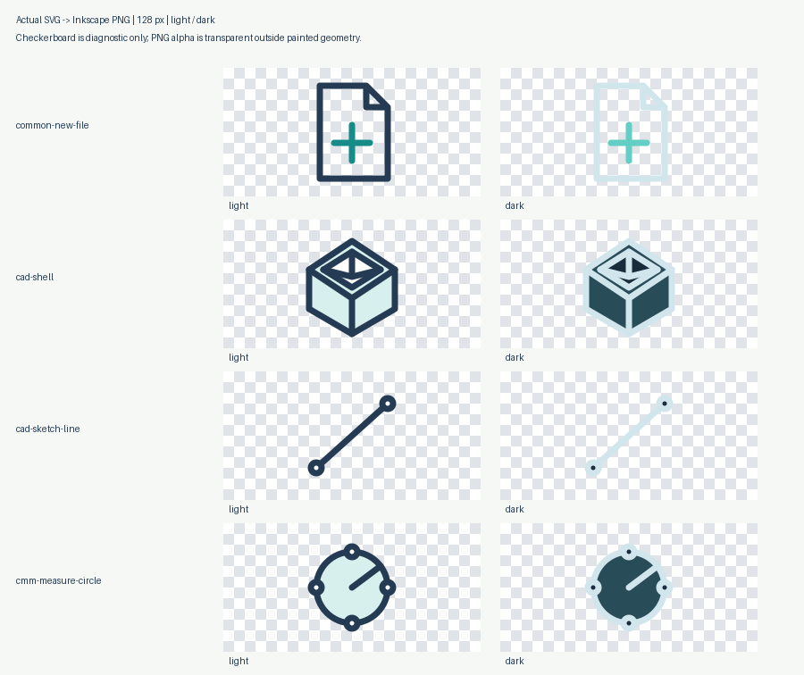

# Transparent PNG export

Date: 2026-10-18. Adds client-side PNG export for the existing **419 meanings / 838 light and dark SVG files**. No SVG geometry, palette, path, hash, manifest entry or catalog count is changed.

## Use

1. Open any icon's detail view.
2. Choose **Icon theme → Light / Dark**. This is the same theme used by preview, Copy SVG and Download SVG.
3. Choose **PNG size**: 16, 24, 32, 48, 64, 128 or 256 px. The initial value is 32 px; gallery preview size has no effect on output dimensions.
4. Click **Download PNG**. The filename includes the semantic ID, theme and size: `cad-extrude.dark.64.png`.

PNG files are generated on demand, not duplicated into the repository. Serve the static catalog locally using the README instructions. The feature requires a modern browser with SVG image decoding, Canvas 2D and `canvas.toBlob`.



These are actual 128 px Inkscape exports composited onto a checkerboard for inspection. The checkerboard is not in the individual PNGs. This is a static diagnostic image, not a browser screenshot.

## What is transparent

A newly created alpha-enabled canvas has no painted background. Only the selected SVG is drawn into it. The gallery's light, dark and checkerboard surfaces are CSS previews and are excluded from export. The result has transparency outside the drawing, including anti-aliased edges.

All authored filled geometry remains filled. In particular, **184 cutout shapes across 64 icon meanings** hide underlying lines and bodies. They stay opaque white for light icons and opaque **#192c3c** for dark icons. Erasing them would reveal hidden geometry. The exported PNG is therefore not a promise that every enclosed region is transparent or that dark cutouts match every application surface. See [theme integration constraints](DARK_THEME.md).

## Implementation

`app.js` uses the existing selected standalone SVG serializer. For PNG only, its root width and height are set to the requested raster dimensions; the 32 × 32 viewBox, source geometry, colors, title and internal references stay intact. A local SVG Blob URL feeds an Image, which is drawn on a new Canvas of exactly the selected width and height. `toBlob(..., 'image/png')` produces the download; there are no conversion services, fetches or uploads.

The request snapshots its icon, theme and size before awaiting decoding or encoding. While it runs, the PNG button is disabled and marked `aria-busy`; repeated invocations are ignored. Other controls can still be used. Moving to the previous/next icon, closing/reopening details or changing theme/size does not mix old and new values. Completion or failure is announced through the active dialog's live status region, or the page status when the dialog is closed.

Unsupported Canvas, decode/draw/encode failures, null/empty/wrong-type blobs and a 15-second decode/encode timeout produce an error rather than an empty PNG. The button becomes available again for retry. SVG image URLs are revoked after completion/failure, PNG download URLs after the download starts, image callbacks and timers are cleared, temporary anchors are removed, and canvas dimensions are reset to release the bitmap. Existing SVG downloads retain their filenames and byte-exact contents.

## Verification

Run:

```sh
python3 tests/test_catalog.py
node --check app.js
node --check catalog.js
node --check tests/test_app.js
node tests/test_app.js
python3 scripts/png_export_audit.py
```

The dependency-free Node harness executes the real application code with mocked browser image/Canvas objects. It checks every **838 selected SVG variants × 7 sizes = 5,866 export pipelines**, including exact SVG source and requested dimensions, unchanged SVG copy/download bytes, independent background and preview-size choices, repeated-click locking, late control changes, previous/next navigation, close/reopen, failures, invalid sizes and URL/timer/bitmap cleanup. Mock PNG blobs are deliberately not presented as raster evidence.

The separate Inkscape/Pillow/NumPy audit directly exports unchanged standalone SVG files at the same requested sizes, without host CSS or embedded-image atlas resampling. Results: **5,866 RGBA PNGs**, exact dimensions, zero blanks, transparent margins, zero light/dark alpha mismatches, and **28** pixel-exact comparisons with independent single-file CLI exports. All **896** cutout probe renders preserve alpha, with **97,910** exposed pixels retaining the exact opaque palette colors.

At 256 px, 124 of 128 cutout-bearing files have pure-color pixel witnesses. The other four are the two themes of `cad-mesh-merge-vertices` and `cmm-cloud-normals`: their radius-1.5 circles and 1.75 px outlines leave an inner radius of 0.625, completely covered by later round-capped 1.75 px paths at their centers. The audit validates those exact shapes, order and styles plus opaque center pixel samples; it does not silently exempt files by ID. An unexplained missing high-resolution witness still fails.

See [`qa/png-export-audit.json`](../qa/png-export-audit.json) for measured coverage and results. This verifies source raster transparency and preserved authored fills independently of the browser mocks.

**Targeted live browser check:** the public catalog was tested in supported cloud Chrome, including selected light/dark 64 × 64 RGBA PNG downloads, 3,511 transparent pixels, equal alpha and different theme RGB. Exact SVG clipboard bytes and native Escape/focus restoration also passed. Full icon/size browser coverage, mobile/other-browser layout and assistive-technology behavior are not verified. The earlier local-file restriction was respected; the now-public Pages URL enabled supported testing. Inkscape images remain separate evidence. See [current QA](QA.md).

For multiple icons, use the [bulk ZIP dialog](BULK_DOWNLOAD.md), which uses this same transparent PNG pipeline with sequential conversion and cancellation.

## Manual browser checklist

- Open a simple icon and a cutout-bearing icon such as `cad-shell`; export both themes at each listed size and verify saved PNG dimensions and RGBA alpha.
- Switch light/dark/checker preview surfaces without changing the theme; compare PNG colors and alpha. No preview surface should be present.
- Change gallery preview size independently of PNG size; export dimensions must follow PNG size.
- Compare exported PNG against the selected SVG. Verify intentional filled shapes remain opaque; dark cutouts should retain #192c3c.
- Double-click PNG and change theme/size while conversion is pending; only one file for the captured original request should start downloading.
- Close/reopen details during conversion and verify a later retry works, with no stale busy state.
- Confirm preparation, completion and error announcements while the native dialog is open, and inspect keyboard/mobile layout.
- Confirm SVG copy/download is unchanged, no console errors occur, and export performs no external network requests.
