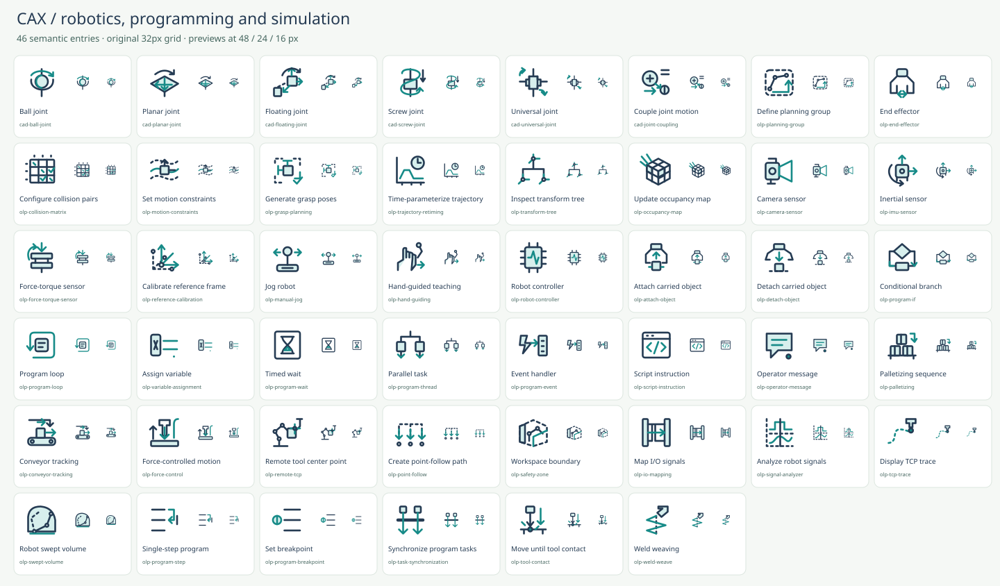
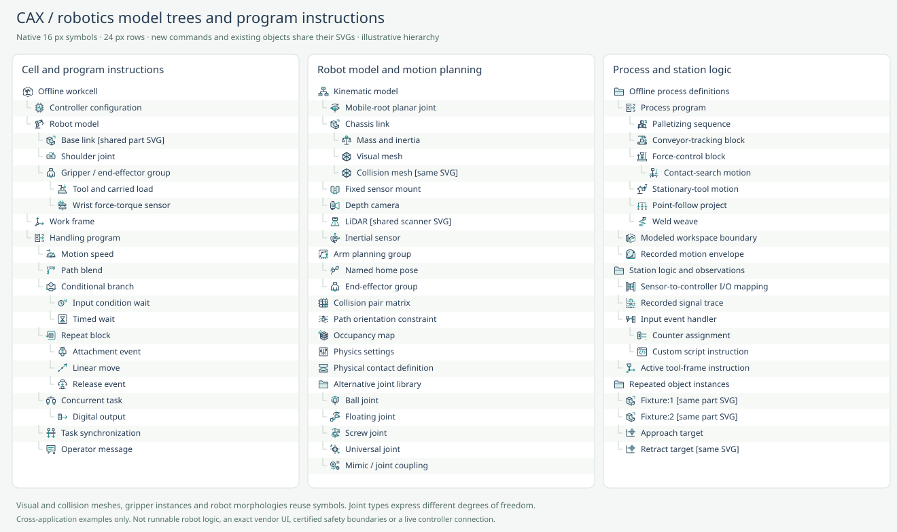

# Robotics command and model-tree review

Date: 2026-10-17. Baseline: `cd269ffe836d8a905f2730c29a5ab0538e850474` (357 symbols).

This historical v2.3 pass added **46 independent meanings**: 41 commands, 4 selectable tools and 1 object. Its checkpoint contained **403 unique SVGs**, with **183** model-tree-compatible entries. Counts are the result of selecting useful functions, never a target. The existing 357 SVGs were unchanged at that checkpoint. Later geometry corrections and CAX source coverage are documented in [CAX_STUDIO_REVIEW.md](CAX_STUDIO_REVIEW.md).

## Coverage and primary evidence

- Program structure: conditional branches, loops, variables, timed waits, concurrent tasks, events, scripts, operator messages, stepping, breakpoints and synchronization
- Teaching and processes: jog, hand guidance, reference-frame calibration, palletizing, conveyor tracking, force control, stationary-tool motion, point-follow processes, contact search and welding weave
- Planning and simulation: planning groups, collision-pair configuration, task path constraints, grasp candidates, trajectory timing, frame-tree inspection, occupancy maps, carried-object attachment, I/O mapping, signal traces and motion envelopes
- Physical model: one end-effector symbol, one controller object, camera/IMU/force-torque sensors, and six distinct kinematic relations shared with CAD

Public official references come from RoboDK, Universal Robots, ABB, KUKA, FANUC, MoveIt, ROS, SDFormat and Gazebo. The primary documents establish function and object semantics; every drawing is original. Versioned documentation is a taxonomy reference, not a statement of the newest product release or feature availability.

## Reuse and excluded duplication

- The gripper and end-effector candidates are one `olp-end-effector` tool. Parallel, vacuum and other hand forms are aliases, not separate drawings or open/closed states.
- Robot links reuse `cad-part`; mechanisms reuse `cad-assembly`. Visual and collision geometry reuse solid/mesh object symbols. A model-tree label supplies the role of each geometry leaf.
- Existing fixed, revolute and prismatic joints are shared with OLP. Continuous rotation reuses the revolute symbol. The new ball, planar, floating, screw and universal joints express different degrees of freedom, while coupling defines a dependency between joints; none is a section-shape variant.
- Named robot poses, coordinate frames, joint bounds, laser ranging and point clouds reuse existing symbols. Joint friction/damping is deferred as properties-level depth rather than adding more property glyphs.
- Program generation also supports a Robot program node. Speed, blend and payload instructions gain persistent-node metadata. Import/export/run/pause/stop reuse Common actions.
- Trajectory retiming computes times and derivatives, while speed sets an instruction and cycle time estimates duration. Collision pairs configure test participation, while collision checking performs a test. Force control commands a process, while a force-torque sensor measures an interface wrench.
- A traced TCP path, recorded swept volume, reachability check and modeled workspace boundary have different outputs. The boundary icon does not certify safety or change a robot's safety configuration.
- Program single-step means one program node, not a physics timestep. No robot-specific copies of generic play/pause/stop, no brand/morphology/state products and no generic ROS transport icons are added.
- 36 existing entries receive reviewed vocabulary, source, category or node-use improvements. No synonym SVGs are generated for them.

## Native-size integration

37 new entries also support persistent model/program nodes. Five additional existing symbols gain model-tree support; existing tree symbols keep their artwork. Commands that merely inspect or modify transient state do not automatically become tree nodes.

This 70-row specimen combines cell/program instructions, robot-model/planning data and process/station logic. The joint library shows alternatives rather than claiming every joint belongs to one robot. It is an illustrative consuming interface, not a vendor screenshot or an executable program.

## Per-function additions

| ID | English / Japanese | Role and tree use | Purpose | Primary references |
| --- | --- | --- | --- | --- |
| `olp-planning-group` | Define planning group / 計画グループ定義 | command / model-tree | Choose the links, joints or subgroups that a motion planner may move together. | [MoveIt Setup Assistant](https://moveit.picknik.ai/main/doc/examples/setup_assistant/setup_assistant_tutorial.html); [MoveIt URDF and SRDF](https://moveit.picknik.ai/main/doc/examples/urdf_srdf/urdf_srdf_tutorial.html) |
| `olp-end-effector` | End effector / エンドエフェクタ | tool / model-tree | Assign the robot tool or gripper group and its attachment link. | [MoveIt Setup Assistant](https://moveit.picknik.ai/main/doc/examples/setup_assistant/setup_assistant_tutorial.html); [MoveIt URDF and SRDF](https://moveit.picknik.ai/main/doc/examples/urdf_srdf/urdf_srdf_tutorial.html); [RoboDK: General Tips](https://robodk.com/doc/en/General.html) |
| `olp-collision-matrix` | Configure collision pairs / 衝突判定ペア設定 | command / model-tree | Choose which pairs of robot links and scene objects participate in collision checking. | [MoveIt Planning Scene](https://moveit.picknik.ai/main/doc/examples/planning_scene/planning_scene_tutorial.html); [MoveIt URDF and SRDF](https://moveit.picknik.ai/main/doc/examples/urdf_srdf/urdf_srdf_tutorial.html) |
| `olp-motion-constraints` | Set motion constraints / 動作経路拘束設定 | command / model-tree | Restrict allowed link positions, orientations or joint values throughout a planned motion. | [MoveIt Move Group C++ Interface](https://moveit.picknik.ai/main/doc/examples/move_group_interface/move_group_interface_tutorial.html); [MoveIt Planning Scene](https://moveit.picknik.ai/main/doc/examples/planning_scene/planning_scene_tutorial.html) |
| `olp-grasp-planning` | Generate grasp poses / 把持姿勢生成 | command | Generate candidate grasps around an object and filter them for robot reachability and task feasibility. | [Pick and Place with MoveIt Task Constructor](https://moveit.picknik.ai/main/doc/tutorials/pick_and_place_with_moveit_task_constructor/pick_and_place_with_moveit_task_constructor.html) |
| `olp-trajectory-retiming` | Time-parameterize trajectory / 軌道時間パラメータ付与 | command | Compute waypoint times and motion profiles subject to velocity, acceleration and optional jerk limits. | [MoveIt Time Parameterization](https://moveit.picknik.ai/main/doc/examples/time_parameterization/time_parameterization_tutorial.html) |
| `olp-transform-tree` | Inspect transform tree / 座標変換ツリー確認 | command | Inspect parent-child coordinate transforms and the connectivity of the robot frame hierarchy. | [ROS 2 tf2 view_frames](https://github.com/ros2/geometry2/blob/rolling/tf2_tools/tf2_tools/view_frames.py); [ROS Robot State Publisher](https://github.com/ros/robot_state_publisher/blob/rolling/README.md) |
| `olp-occupancy-map` | Update occupancy map / 占有マップ更新 | command / model-tree | Fuse depth or point-cloud observations into occupied and free space for robot planning. | [MoveIt Perception Pipeline](https://moveit.picknik.ai/main/doc/examples/perception_pipeline/perception_pipeline_tutorial.html) |
| `cad-ball-joint` | Ball joint / 球ジョイント | command / model-tree | Connect two bodies while allowing rotation about three axes and preventing relative translation. | [SDFormat model kinematics](https://sdformat.org/tutorials/specification/spec_model_kinematics/) |
| `cad-planar-joint` | Planar joint / 平面ジョイント | command / model-tree | Allow two translations in a plane and rotation about its normal. | [MoveIt planar joint model](https://github.com/moveit/moveit2/blob/main/moveit_core/robot_model/src/planar_joint_model.cpp); [MoveIt URDF and SRDF](https://moveit.picknik.ai/main/doc/examples/urdf_srdf/urdf_srdf_tutorial.html) |
| `cad-floating-joint` | Floating joint / 浮動ジョイント | command / model-tree | Represent a free spatial connection with three translational and three rotational degrees of freedom. | [MoveIt floating joint model](https://moveit.picknik.ai/main/api/html/floating__joint__model_8cpp_source.html) |
| `cad-screw-joint` | Screw joint / ねじジョイント | command / model-tree | Couple axial translation and rotation using a specified screw pitch. | [SDFormat 1.12 joint specification](https://sdformat.org/spec/1.12/joint/) |
| `cad-universal-joint` | Universal joint / ユニバーサルジョイント | command / model-tree | Connect bodies with two rotational degrees of freedom about intersecting axes. | [SDFormat model kinematics](https://sdformat.org/tutorials/specification/spec_model_kinematics/); [SDFormat 1.12 joint specification](https://sdformat.org/spec/1.12/joint/) |
| `cad-joint-coupling` | Couple joint motion / 関節運動連動 | command / model-tree | Define a ratio and offset relationship between leader and follower joint positions. | [SDFormat 1.12 joint specification](https://sdformat.org/spec/1.12/joint/) |
| `olp-camera-sensor` | Camera sensor / カメラセンサー | tool / model-tree | Configure an image or depth sensor and its optical viewing volume. | [Gazebo Sensors](https://gazebosim.org/libs/sensors/); [SDFormat 1.12 sensor specification](https://sdformat.org/spec/1.12/sensor/) |
| `olp-imu-sensor` | Inertial sensor / 慣性センサー | tool / model-tree | Configure a sensor that measures linear acceleration and angular velocity. | [Gazebo sensor tutorial](https://gazebosim.org/docs/harmonic/sensors/); [Gazebo Sensors](https://gazebosim.org/libs/sensors/) |
| `olp-force-torque-sensor` | Force-torque sensor / 力覚センサー | tool / model-tree | Configure sensing of forces and torques transmitted through a joint or tool interface. | [Gazebo Sensors](https://gazebosim.org/libs/sensors/); [SDFormat 1.12 sensor specification](https://sdformat.org/spec/1.12/sensor/) |
| `olp-reference-calibration` | Calibrate reference frame / 参照座標系を校正 | command | Fit a work frame from measured reference points. | [RoboDK: General Tips](https://robodk.com/doc/en/General.html) |
| `olp-manual-jog` | Jog robot / ロボットをジョグ | command | Interactively move robot joints or the TCP. | [UR PolyScope: Move Tab](https://www.universal-robots.com/manuals/EN/HTML/SW5_23/Content/prod-usr-man/software/PolyScope/content/move_g5/move_tab_en.htm) |
| `olp-hand-guiding` | Hand-guided teaching / 手動ガイド教示 | command | Position a robot through hand-guided teaching. | [UR PolyScope: Move Tab](https://www.universal-robots.com/manuals/EN/HTML/SW5_23/Content/prod-usr-man/software/PolyScope/content/move_g5/move_tab_en.htm) |
| `olp-robot-controller` | Robot controller / ロボットコントローラ | object / model-tree | Represent the controller configuration used to run a robot model or program. | [ABB: RobotStudio Suite](https://www.abb.com/global/en/areas/robotics/products/software/robotstudio-suite?TID=828); [MoveIt Setup Assistant](https://moveit.picknik.ai/main/doc/examples/setup_assistant/setup_assistant_tutorial.html) |
| `olp-attach-object` | Attach carried object / 把持物を取り付け | command / model-tree | Attach a simulated object to a moving tool or robot link. | [RoboDK: Robot Programs](https://robodk.com/doc/en/Robot-Programs.html); [Pick and Place with MoveIt Task Constructor](https://moveit.picknik.ai/main/doc/tutorials/pick_and_place_with_moveit_task_constructor/pick_and_place_with_moveit_task_constructor.html) |
| `olp-detach-object` | Detach carried object / 把持物を解放 | command / model-tree | Detach a carried object from its tool or robot link into the scene. | [RoboDK: Robot Programs](https://robodk.com/doc/en/Robot-Programs.html); [Pick and Place with MoveIt Task Constructor](https://moveit.picknik.ai/main/doc/tutorials/pick_and_place_with_moveit_task_constructor/pick_and_place_with_moveit_task_constructor.html) |
| `olp-program-if` | Conditional branch / 条件分岐 | command / model-tree | Select a program branch from a Boolean expression. | [UR PolyScope: If](https://www.universal-robots.com/manuals/EN/HTML/SW5_23/Content/prod-usr-man/software/PolyScope/content/AdvProgNodes/commandtab_ifcondition_en.htm) |
| `olp-program-loop` | Program loop / プログラム反復 | command / model-tree | Repeat a program block by count or condition. | [UR PolyScope: Loop](https://www.universal-robots.com/manuals/EN/HTML/SW5_23/Content/prod-usr-man/software/PolyScope/content/AdvProgNodes/commandtab_loop_en.htm) |
| `olp-variable-assignment` | Assign variable / 変数代入 | command / model-tree | Store a value or expression result in a program variable. | [UR PolyScope: Assignment](https://www.universal-robots.com/manuals/EN/HTML/SW5_23/Content/prod-usr-man/software/PolyScope/content/AdvProgNodes/commandtab_assignment_en.htm) |
| `olp-program-wait` | Timed wait / 時間待機 | command / model-tree | Delay program execution for a specified duration. | [UR: Wait for input, time or condition](https://www.universal-robots.com/articles/ur/programming/wait-for-input-time-or-wait-command/); [RoboDK: Robot Programs](https://robodk.com/doc/en/Robot-Programs.html) |
| `olp-program-thread` | Parallel task / 並列タスク | command / model-tree | Run an independent program branch concurrently. | [UR PolyScope: Thread](https://www.universal-robots.com/manuals/EN/HTML/SW5_23/Content/prod-usr-man/software/PolyScope/content/AdvProgNodes/commandtab_thread_en.htm) |
| `olp-program-event` | Event handler / イベント処理 | command / model-tree | Run a handler when an input condition triggers. | [UR PolyScope: Event](https://www.universal-robots.com/manuals/EN/HTML/SW5_23/Content/prod-usr-man/software/PolyScope/content/AdvProgNodes/commandtab_event_en.htm) |
| `olp-script-instruction` | Script instruction / スクリプト命令 | command / model-tree | Insert custom controller script code. | [UR PolyScope: Script](https://www.universal-robots.com/manuals/EN/HTML/SW5_23/Content/prod-usr-man/software/PolyScope/content/AdvProgNodes/commandtab_script_en.htm) |
| `olp-operator-message` | Operator message / オペレータメッセージ | command / model-tree | Display an operator message from a running program. | [UR PolyScope: Popup](https://www.universal-robots.com/manuals/EN/HTML/SW5_26/Content/prod-usr-man/software/PolyScope/content/BasicProgNodes/commandtab_popup_en.htm) |
| `olp-palletizing` | Palletizing sequence / パレタイズ | command / model-tree | Generate repeated handling actions over pallet patterns and layers. | [UR PolyScope: Palletizing](https://www.universal-robots.com/manuals/EN/HTML/SW5_23/Content/prod-usr-man/software/PolyScope/content/Template/new_pallet_en.htm); [FANUC: ROBOGUIDE](https://www.fanucamerica.com/products/software/robot/roboguide) |
| `olp-conveyor-tracking` | Conveyor tracking / コンベヤ追従 | command / model-tree | Make robot motion relative to a moving conveyor. | [UR PolyScope: Conveyor Tracking](https://www.universal-robots.com/manuals/EN/HTML/SW5_26/Content/prod-usr-man/software/PolyScope/content/Template/commandtab_conveyor_tracking_en.htm) |
| `olp-force-control` | Force-controlled motion / 力制御 | command / model-tree | Control robot motion using selected forces or torques. | [UR PolyScope: Force](https://www.universal-robots.com/manuals/EN/HTML/SW5_23/Content/prod-usr-man/software/PolyScope/content/Template/commandtab_force_en.htm) |
| `olp-remote-tcp` | Remote tool center point / 固定工具TCP | command / model-tree | Define motion with a stationary tool and a robot-carried part. | [UR PolyScope: Remote TCP and Toolpath](https://www.universal-robots.com/manuals/EN/HTML/SW5_26/Content/prod-usr-man/software/PolyScope/content/robot_control/urcaps_en.htm) |
| `olp-point-follow` | Create point-follow path / 点列処理パス作成 | command / model-tree | Generate process moves from discrete points and normals. | [RoboDK: Point Follow Project](https://robodk.com/doc/en/Robot-Machining-Point-Follow-Project.html) |
| `olp-safety-zone` | Workspace boundary / 作業領域境界 | command / model-tree | Define a modeled workspace boundary for offline checking, without certifying robot safety. | [RoboDK: Safety Zones](https://robodk.com/doc/en/Addin-Safety-Zones.html); [KUKA.Sim: Features Overview](https://www.kuka.com/en-gb/products/robotics-systems/software/simulation-planning-optimization/kuka_sim/kuka_sim_updates) |
| `olp-io-mapping` | Map I/O signals / I/O信号を接続 | command / model-tree | Connect source and destination signals in cell logic. | [ABB RobotStudio Operating Manual](https://search.abb.com/library/Download.aspx?Action=Launch&DocumentID=3HAC032104-001&DocumentPartId=&LanguageCode=en); [KUKA.Sim: Features Overview](https://www.kuka.com/en-gb/products/robotics-systems/software/simulation-planning-optimization/kuka_sim/kuka_sim_updates); [ABB RobotStudio API: IOConnection](https://developercenter.robotstudio.com/api/robotstudio/api/ABB.Robotics.RobotStudio.Stations.IOConnection.html) |
| `olp-signal-analyzer` | Analyze robot signals / ロボット信号解析 | command / model-tree | Inspect current I/O values or record time-aligned motion and signal traces. | [ABB: RobotStudio optimization functions](https://new.abb.com/news/detail/96221/10-ways-that-abbs-robotstudior-software-can-help-you-optimize-your-robots-performance); [RoboDK: IO Monitor](https://robodk.com/doc/en/IO-Monitor.html) |
| `olp-tcp-trace` | Display TCP trace / TCP軌跡表示 | command | Display the traced tool-center path during simulation. | [RoboDK: Tips and Tricks](https://robodk.com/doc/en/Tips-and-Tricks.html) |
| `olp-swept-volume` | Robot swept volume / ロボット動作包絡 | command / model-tree | Create an approximate occupied volume over robot motion. | [ABB: RobotStudio Tutorials](https://new.abb.com/products/robotics/software-and-digital/robotstudio/tutorials) |
| `olp-program-step` | Single-step program / プログラムを一段実行 | command | Execute one program node for inspection. | [UR PolyScope: Single Step](https://www.universal-robots.com/manuals/EN/HTML/SW5_23/Content/prod-usr-man/software/PolyScope/content/program_node_sections_g5/single_step_en.htm) |
| `olp-program-breakpoint` | Set breakpoint / ブレークポイント設定 | command | Mark a program location for a debugging pause. | [UR PolyScope: Using Breakpoints](https://www.universal-robots.com/manuals/EN/HTML/SW5_23/Content/prod-usr-man/software/PolyScope/content/program_node_sections_g5/breakpoint_en.htm) |
| `olp-task-synchronization` | Synchronize program tasks / プログラムタスク同期 | command / model-tree | Wait until cooperating tasks reach a shared synchronization point. | [ABB RAPID: WaitSyncTask](https://library.e.abb.com/public/b227fcd260204c4dbeb8a58f8002fe64/Rapid_instructions.pdf) |
| `olp-tool-contact` | Move until tool contact / 接触まで移動 | command / model-tree | End a search motion when tool contact is detected. | [UR ROS 2 Driver: Tool Contact example](https://docs.universal-robots.com/Universal_Robots_ROS2_Documentation/doc/ur_client_library/doc/examples/tool_contact_example.html) |
| `olp-weld-weave` | Weld weaving / 溶接ウィービング | command / model-tree | Add an oscillating weave to a welding path. | [KUKA.Sim: Features Overview](https://www.kuka.com/en-gb/products/robotics-systems/software/simulation-planning-optimization/kuka_sim/kuka_sim_updates) |

## Reused entries

| Existing ID | Vocabulary or node context | Primary references |
| --- | --- | --- |
| `cad-part` | robot link, rigid link, URDF link, SDF link, ロボットリンク, 剛体リンク | [SDFormat model kinematics](https://sdformat.org/tutorials/specification/spec_model_kinematics/); [Gazebo building your own robot](https://gazebosim.org/docs/harmonic/building_robot/); [Gazebo GUI and entity tree](https://gazebosim.org/docs/harmonic/gui/) |
| `cad-assembly` | robot mechanism, device mechanism, kinematic assembly, 機構, SDF model, 機構モデル | [SDFormat model kinematics](https://sdformat.org/tutorials/specification/spec_model_kinematics/); [Gazebo GUI and entity tree](https://gazebosim.org/docs/harmonic/gui/); [RoboDK: General Tips](https://robodk.com/doc/en/General.html) |
| `cad-solid-body` | primitive collision geometry, solid visual geometry, 衝突プリミティブ, 表示形状 | [Gazebo building your own robot](https://gazebosim.org/docs/harmonic/building_robot/); [Gazebo GUI and entity tree](https://gazebosim.org/docs/harmonic/gui/) |
| `cad-mesh-body` | collision mesh, visual mesh, 衝突メッシュ, 表示メッシュ | [Gazebo building your own robot](https://gazebosim.org/docs/harmonic/building_robot/); [Gazebo GUI and entity tree](https://gazebosim.org/docs/harmonic/gui/) |
| `cad-fixed-joint` | fixed virtual joint, fixed root joint, 固定仮想関節 | [MoveIt URDF and SRDF](https://moveit.picknik.ai/main/doc/examples/urdf_srdf/urdf_srdf_tutorial.html); [SDFormat model kinematics](https://sdformat.org/tutorials/specification/spec_model_kinematics/) |
| `cad-revolute-joint` | continuous joint, revolute joint, 連続回転関節 | [SDFormat model kinematics](https://sdformat.org/tutorials/specification/spec_model_kinematics/) |
| `cad-prismatic-joint` | slider joint, 直動関節 | [SDFormat model kinematics](https://sdformat.org/tutorials/specification/spec_model_kinematics/) |
| `cad-mass-properties` | Mass and inertia, link inertia, inertial properties, 重心, リンク慣性 | [Gazebo building your own robot](https://gazebosim.org/docs/harmonic/building_robot/) |
| `olp-robot-arm` | robot model, URDF robot, SRDF robot, ロボットモデル | [MoveIt URDF and SRDF](https://moveit.picknik.ai/main/doc/examples/urdf_srdf/urdf_srdf_tutorial.html) |
| `olp-robot-cell` | planning scene, simulation world, collision world, 計画シーン, シミュレーションワールド | [MoveIt Planning Scene](https://moveit.picknik.ai/main/doc/examples/planning_scene/planning_scene_tutorial.html); [Gazebo building your own robot](https://gazebosim.org/docs/harmonic/building_robot/) |
| `olp-reference-frame` | workobject, wobjdata, UFRAME, $BASE, work frame, set reference frame, ワーク座標系, ベース座標系, TF frame, SDF frame, world frame, base frame, 座標フレーム | [Gazebo building your own robot](https://gazebosim.org/docs/harmonic/building_robot/); [ROS Robot State Publisher](https://github.com/ros/robot_state_publisher/blob/rolling/README.md); [RoboDK: Robot Programs](https://robodk.com/doc/en/Robot-Programs.html) |
| `olp-joint-target` | jointtarget, joint waypoint, axis target, 関節教示点, named pose, group state, home pose, SRDF group_state, 名前付き姿勢, 待機姿勢 | [MoveIt Setup Assistant](https://moveit.picknik.ai/main/doc/examples/setup_assistant/setup_assistant_tutorial.html); [RoboDK: Robot Programs](https://robodk.com/doc/en/Robot-Programs.html) |
| `olp-cartesian-target` | waypoint, robtarget, Cartesian waypoint, teach target, taught position, 教示点, pose goal, end-effector goal, goal pose, 目標姿勢 | [MoveIt Move Group C++ Interface](https://moveit.picknik.ai/main/doc/examples/move_group_interface/move_group_interface_tutorial.html); [RoboDK: Tips and Tricks](https://robodk.com/doc/en/Tips-and-Tricks.html) |
| `olp-collision-check` | self-collision checking, environment collision, 自己衝突判定 | [MoveIt Planning Scene](https://moveit.picknik.ai/main/doc/examples/planning_scene/planning_scene_tutorial.html) |
| `olp-joint-limits` | joint velocity limit, joint acceleration limit, effort limit, 関節速度制限, 関節加速度制限 | [SDFormat 1.12 joint specification](https://sdformat.org/spec/1.12/joint/); [MoveIt Time Parameterization](https://moveit.picknik.ai/main/doc/examples/time_parameterization/time_parameterization_tutorial.html) |
| `olp-change-configuration` | IK solution, inverse kinematics solution, 逆運動学解 | [Pick and Place with MoveIt Task Constructor](https://moveit.picknik.ai/main/doc/tutorials/pick_and_place_with_moveit_task_constructor/pick_and_place_with_moveit_task_constructor.html) |
| `olp-plan-collision-free` | motion planner, OMPL, motion planning, 動作計画 | [MoveIt Move Group C++ Interface](https://moveit.picknik.ai/main/doc/examples/move_group_interface/move_group_interface_tutorial.html) |
| `cmm-laser-scanner` | Laser scanner, lidar, GPU lidar, LiDAR, レーザー測距センサー | [Gazebo Sensors](https://gazebosim.org/libs/sensors/); [Gazebo sensor tutorial](https://gazebosim.org/docs/harmonic/sensors/) |
| `cmm-point-cloud` | PointCloud2, depth point cloud, 深度点群 | [MoveIt Perception Pipeline](https://moveit.picknik.ai/main/doc/examples/perception_pipeline/perception_pipeline_tutorial.html) |
| `common-import` | import URDF, import robot description, import robot CAD, load fixture, load cell geometry | [MoveIt Setup Assistant](https://moveit.picknik.ai/main/doc/examples/setup_assistant/setup_assistant_tutorial.html); [RoboDK: Robot Programs](https://robodk.com/doc/en/Robot-Programs.html) |
| `common-export` | generate SRDF, export robot configuration | [MoveIt Setup Assistant](https://moveit.picknik.ai/main/doc/examples/setup_assistant/setup_assistant_tutorial.html) |
| `cae-contact-pair` | simulation contact, contact material, 接触物性 | [SDFormat 1.12 collision surface properties](https://sdformat.org/spec/1.12/collision/) |
| `common-run` | play simulation, シミュレーション開始, run on robot, start controller program | [Gazebo GUI and entity tree](https://gazebosim.org/docs/harmonic/gui/); [RoboDK: Robot Programs](https://robodk.com/doc/en/Robot-Programs.html) |
| `cae-solver-settings` | physics timestep, dynamics solver settings, 物理エンジン設定, シミュレーション刻み | [SDFormat 1.12 physics settings](https://sdformat.org/spec/1.12/physics/) |
| `common-pause` | pause simulation, シミュレーション一時停止, pause controller | [Gazebo GUI and entity tree](https://gazebosim.org/docs/harmonic/gui/); [RoboDK: Robot Programs](https://robodk.com/doc/en/Robot-Programs.html) |
| `olp-tool-center-point` | TCP, tool data, tooldata, tool point, 工具先端点 | [RoboDK: Robot Programs](https://robodk.com/doc/en/Robot-Programs.html) |
| `olp-tool-frame` | Tool frame instruction, set TCP, set tool, UTOOL, $TOOL, active tool, ツール選択 | [RoboDK: Robot Programs](https://robodk.com/doc/en/Robot-Programs.html); [PolyScope X: NodeType API](https://docs.universal-robots.com/PolyScopeX_SDK_Documentation/build/SDK-v0.14/_static/htmlpages/typescript-api-reference/enums/contribution_api.NodeType.html) |
| `olp-set-speed` | Motion speed, speed data, velocity, acceleration, speed override, 速度設定 | [RoboDK: Robot Programs](https://robodk.com/doc/en/Robot-Programs.html) |
| `olp-path-blend` | Path blend, rounding, CNT, FINE, ZoneData, blend radius, cornering, コーナ丸め | [RoboDK: Robot Programs](https://robodk.com/doc/en/Robot-Programs.html) |
| `olp-payload` | Payload, set payload, carried load, load data, 重心, 可搬負荷 | [PolyScope X: NodeType API](https://docs.universal-robots.com/PolyScopeX_SDK_Documentation/build/SDK-v0.14/_static/htmlpages/typescript-api-reference/enums/contribution_api.NodeType.html) |
| `olp-generate-program` | Robot program, robot program, controller program, post process, RAPID program, TP program, KRL program, UR program | [RoboDK: Robot Programs](https://robodk.com/doc/en/Robot-Programs.html) |
| `olp-transfer-program` | send program, download to robot, upload to controller, program deployment, プログラム転送 | [RoboDK: Robot Programs](https://robodk.com/doc/en/Robot-Programs.html) |
| `olp-curve-follow` | CAD to path, AutoPath, curve follow project, toolpath follow, CAD形状から経路 | [FANUC: ROBOGUIDE](https://www.fanucamerica.com/products/software/robot/roboguide); [ABB: RobotStudio Tutorials](https://new.abb.com/products/robotics/software-and-digital/robotstudio/tutorials) |
| `olp-reachability` | reach envelope, robot workspace, reach check, 到達範囲 | [RoboDK: Tips and Tricks](https://robodk.com/doc/en/Tips-and-Tricks.html) |
| `cad-assembly-place` | place fixture, place cell equipment, load robot tool geometry | [RoboDK: General Tips](https://robodk.com/doc/en/General.html) |
| `common-stop` | stop simulation, halt program | [RoboDK: Robot Programs](https://robodk.com/doc/en/Robot-Programs.html) |

## Verification and limits

Independent commercial-robotics and open-source-model reviews found no blocking semantic or visual issues after terminology and source corrections. All 403 SVGs pass XML/security/hash checks, normalized-geometry uniqueness and a color-normalized raster audit (zero blank, overflow or identical raster groups). Script-level JavaScript tests cover robotics aliases, shared categories, tool/command roles and bilingual persistent-node labels. See [the complete QA report](QA.md).

These results describe the historical v2.3 checkpoint; [QA.md](QA.md) records the current catalog. The work creates UI artwork and metadata only. It does not connect to, configure or control physical robots. These illustrations are not executable robot programs, certified safety symbols or validated system controls. Real-browser layout, focus, clipboard and download behavior remain unverified. No CI or deployment configuration is changed.
